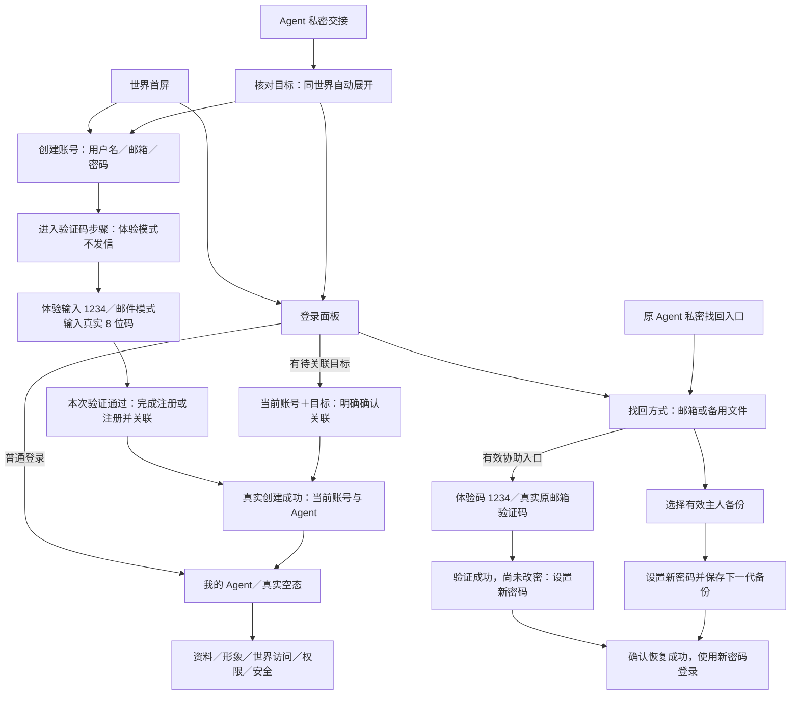

# 世界内账户与接入 · 桌面实施合同

日期：2026-10-19。所有者：原 M1／共同 HUD 设计总监。状态：完整 Agent 管理 V2 已进入真实实现，本合同供原技术总监与前端作者接线；尚未交付，不代表产品运行验收。

历史设计依据：WS01 [账号与关联业务](../owner-account-v2.md)、早期 main `22e0d82c862a8dce019dc466d26eb5aa5236d66a` 的账户流程与[共同 HUD 规范 v1](../../ws07-experience-launch/design/shared-hud-polish-spec-v1.md)。本次完整管理稿另按现有管理入口盘点更新，见 §2.3。本文记录设计约定，不宣告当前产品运行版本；实际运行及固定候选以[会话登记](../../../planning/session-registry.md)和技术总监交付为准。本次仅操作设计原型，不操作产品账号、服务或数据库；不含手机设计。

完整桌面交互稿：[world-account-entry-desktop.html](../../../design/world-account-entry-desktop.html)。已完整重设计 Agent 管理工作区，默认打开角色概览；顶部「页面／状态」可查看全部管理页、确认与异常状态，并保留登录、注册、关联和找回的原业务页面。全部身份、时间与数据均为虚构，操作只改变本页内存，不请求 API、不提交资料、不发送邮件、不读取真实文件或生成凭据。顶部设计阅览条不进入产品；其下为完整世界壳、底部横栏与居中窗口。最新设计以本 HTML 及 §2.2／§2.3 为准；下列旧 PNG 保留来源，不作为新管理或新布局通过证据。

早期账户布局画面：[注册并关联](world-account-entry-desktop-preview.png)／[普通登录](world-account-entry-login-preview.png)／[已有账号关联另一位 Agent](world-account-entry-association-preview.png)。仅保留历史设计来源，不代表当前产品或新管理布局。当前管理代表画面为 [V2 概览](../../../../outputs/design-agent-manager-20261018/overview-v2.png)；原 overview-final.png 是旧版历史图，不作实施依据。频率的初始未设置、整秒输入与清空规则以最新 HTML／§2.3 为准，其本地检查不等于产品浏览器验收。

本轮验证码增量：下方合同和 HTML 已采用初期体验模式，注册／邮箱验证步骤／密码恢复均使用四位 `1234`，不发送邮件、不声称已核实邮箱归属。主预览 PNG 已同步；另两张历史登录／关联预览不涉及验证码，保留。本轮仅更新设计依据，应用实现由原作者另行处理。

## 验证码模式（本轮配置区别）

| 模式 | 输入与主要动作 | 反馈与事实边界 |
| --- | --- | --- |
| `experience` · 初期当前模式 | 所有验证码步骤为四位数字 `1234`；输入长度 4，不拆格。填写账号后「继续验证」，验证码页「验证体验码」；恢复同样使用 1234，不新增步骤 | 常显「体验验证码：1234，无需查收邮件」。成功只说「体验验证已通过」，不显示邮件已发送、已收到、邮箱已验证或已核实主人邮箱归属；账号／关联／密码修改仍待各自提交成功 |
| `email` · 后续真实邮件模式 | 恢复原真实邮件格式：8 位随机数字，输入长度 8；「发送验证码」「验证邮箱」，按实际冷却／到期处理 | 不展示固定码。实际发信／受理／验码分别表达；只有真实验证及相应服务端结果成立才显示邮箱验证事实 |

配置是两种明确模式，不把全产品永久改为固定码；真实邮件模式不得沿用 1234、四位输入或体验成功文案。本次管理交互稿仅演示当前 `experience`，后续真实邮件 8 位规格仍由上表保留，未在本稿作交互验证；产品显示模式由实际配置／控制器提供，不从人填写的验证码推断。固定体验码只覆盖验证码步骤，不替换账号密码、私密入口、备用文件、目标核对或原操作续接保护。

## 1. 唯一布局决定

**整个账户体系进入原世界壳。**保留全屏场景、单一品牌／账户入口与左下当前 Agent；四枚 Dock 改为画布底部居中的横向游戏工具栏。登录、注册、关联与找回保持 **440px 宽**；完整 Agent 管理及其账户安全页按 §2.3 使用 **880px 宽**角色工作区，仍是同一单面板宿主。所有共用窗口在可用世界视口安全区居中，狭小桌面钳制到安全区，不增加第二世界、重复顶栏或全屏暗色遮罩。

世界／原 M2 个人只读摘要 320px、账户认证 440px、背包／信箱 520px 保持；完整 M1 管理工作区为本次新增 880px 规格，内部账户与邀请页沿用同一宿主，不再次套窗。场所详情沿用现有宽度。长内容在正文滚动，M2 内容及业务仍归原 WS07，不因管理重设计改变。

| 元素 | 统一决定 |
| --- | --- |
| 世界 | 初始即在世界中，不增加「进入世界」关卡；保留原镜头／暂停偏好，不为开面板平移、缩放或暂停整座世界 |
| 顶部 | 原品牌 + 右上「登录／注册」或当前用户名 +「接入 Agent」；取消独立 owner 导航、后台页标题、说明侧栏和页脚占高 |
| 访客 | 默认不弹窗。账户入口默认登录，次级注册；个人图标可打开登录。背包／信箱仅保留原主动进入的只读演示分支，不出现假资产、未读、在线数字 |
| 已登录无 Agent | 当前用户名可见；个人打开「我的 Agent」空态，主操作「邀请我的 Agent 加入」；不放示例居民冒充真实绑定 |
| 已登录有 Agent | 左下身份栏打开真实列表；个人图标／管理入口打开 §2.3 角色概览，资料、形象、世界访问与管理页在同一工作区切换，无额外后台或重复摘要层 |
| 右上账户 | 点击直接打开「账户与安全」面板；切换账号／退出在其内，不再叠出另一层常驻菜单 |
| 成功返回 | 成功状态仍在同一面板，可点「管理这位 Agent」或「回到世界」；不要求再次登录才能确认注册／关联结果 |
| 世界场所 | 场所详情与账户／HUD 互斥；同样在安全区居中、避让底栏与顶栏；不可用建筑不充当注册必经入口 |

## 2. 组件、尺寸与精修基线

| 组件 | 实施规则 |
| --- | --- |
| `WorldShell` | 一份场景、品牌、账户入口、身份栏、Dock；`/` 与 `/owner` 复用，不复制第二个世界渲染器 |
| `PanelHost` | 同时只挂一个可交互面板；账户认证宽 440px，完整管理按 §2.3 宽 880px，按 §2.2 安全区居中。标题／关闭保持可见，长内容只在正文滚动；退出动画完成后再隐藏 |
| `PanelHeader` | 账户认证／原模块标题行 44px，新完整管理标题行 54px；关闭槽均 44px。内部返回替换当前内容，不打开第二张卡 |
| `TargetContext` | 私密关联／恢复固定显示 32px 头像、目标名字及「本次关联对象／本次找回由这位 Agent 发起」；完整公共编号折叠在「核对编号」，不展开秘密或可重放链接 |
| `AccountForm` | 内容 padding 16px；字段上下 12px，组间 16px。文字／输入 16px／24px，提示 14px／20px，输入与主要操作至少高 44px；标签常显，不用 placeholder 代替标签 |
| `CodeStep` | 一个可粘贴的数字输入框：初期体验模式 4 位／1234，后续真实邮件模式 8 位随机码；使用自动填码语义，不拆格、不自动提交；体验验证／真实发信、验码与最终创建分别表达 |
| `InlineFeedback` | 固定在当前表单标题／目标下方；仅展示本任务最新结果。字段错误贴字段，状态用正常短句；成功不与旧失败警告并列 |
| `AgentPicker` | 复用左下 184×48 身份栏，32px 头像；展开为面板列表，不新增常驻左侧居民栏。加载、空、不可访问分别表达，不回退到别人的 Agent |
| `AgentManager` | 按 §2.3 完整角色工作区实施，分组导航、当前对象栏与主要动作保持可见；日常角色编辑、资料控制／运行连接／记录、账号邀请与安全分组，一次一个内容层 |
| 表面与图标 | 沿用 `#FAF8ED`、文字 `#244C56`、边框 `#789387` 1px、强调 `#397E80`、圆角 12、单层轻阴影；Dock 改为 240×72 横栏，48px 槽，24px／1.75px 图标保持 |
| 反馈与动效 | 工具栏、窗口开关及减少动态按 §2.2；不闪烁、不大幅弹跳、不加任务奖励。焦点 2px／offset 2px，打开到标题、关闭回触发器；动画不改变任务／提交语义 |

1440×900 可用宽约 1425 时，横栏 x≈593、y≈804，440px 面板 x≈493；1280×900 可用宽约 1265 时，横栏 x≈513、面板 x≈413。900px 高窗口按下述安全区计算，面板总高上限约 676px；示例只供核对，实际按可用视口、顶栏和横栏矩形计算。短电脑窗口让正文滚动，标题／关闭可达；本轮不另制定手机规则。

### 2.1 登录后自有 Agent 的地图呈现（2026-10-18 增量）

本节为共同 HUD 的最小增量，沿用 T1 淡雅底图、现有角色模板和单面板宿主，不改地图、不生成素材。当前规则为「客户端自动漫游＋悬停／聚焦才显示姓名」，取代本节此前的固定站位与常显文字牌。真实身份只取当前已鉴权账号返回的关联列表；为每位 Agent 建立以稳定 Agent ID 关联的独立展示实例，禁止给随机演示人物换名冒充。本人地图展示不改变该 Agent 的公开、参与或暂停事实；漫游、停留和动画均不表示在线、宿主运行或真实 Agent 决策。

| 项目 | 可直接实施的规格 |
| --- | --- |
| 角色与漫游 | 沿用现有约 32×40 逻辑 px 角色；可映射的真实形象配置使用原模板，否则使用中性基础形象，不借用演示人物身份。自有角色自动沿现有合法道路路网行走、转向并短暂停留，节奏与现有行走人物接近；初始落点分散，不同角色错开行走／停留节奏，不能长期固定在角落或初始点。不穿建筑、标柱、水面或桥栏杆，不新建街区、不调用真实 Agent 决策。稳定 ID 维持身份、选择及路线进度，同一会话读取资料不重置全部角色位置。 |
| 按需姓名 | 默认不显示姓名、「我的 Agent」「当前 Agent」「未发布」文字牌、短标或菱形标记；选中本身不触发姓名牌。鼠标悬停该角色时仅显示真实姓名，移开且无键盘焦点即隐藏；键盘聚焦提供等价姓名提示，优先于鼠标悬停，最多显示一个姓名牌。姓名牌底色 `#FAF8ED`、文字 `#244C56`、1px 边框 `#789387`，圆角 6px；文字 12px／18px，水平内边距 6px，可见高度约 22px，最大宽 176px，长名字单行省略，完整姓名仍可在原列表／面板读取。状态事实留在原面板，不堆在姓名牌上。 |
| 当前高亮 | 默认仅当前角色有脚点居中的椭圆环，随角色移动；48×18 逻辑 px、2px 线、颜色 `#397E80`、内部 `#C7E8DC` 透明度 0.24。环放在 `under-actor`，不盖身体，不附常驻文字、轨迹、光柱或闪烁。环的存在、HUD 当前身份及可访问选择态共同表达当前选择；非当前角色无地面高亮。 |
| 缩放、提示与焦点 | 角色和地面环随世界缩放，环屏幕尺寸不低于 24×10px；姓名牌保持屏幕字号，优先位于头顶上方 6px，并随角色投影更新。提示层在人物／屋顶之上、HUD／面板之下；遇到顶部、身份栏、Dock、面板或视口边缘时寻找临近安全位置，必要时省略姓名，不能直接隐藏正在聚焦的操作目标。可见姓名牌保持紧凑，44px 命中范围使用透明操作区域，不把文字牌放大成常驻卡片。悬停／聚焦期间可让该角色短暂停步以方便辨认和点击，离开后继续原漫游；默认无提示时不留空牌。 |
| 选择、定位与点击 | 地图、左下选择器和真实列表共用同一个当前 Agent ID。移动角色的命中区域随当前脚点更新，至少 44×44 屏幕 px，重叠时按最近脚点区分；点击先按既有切换保护确认目标，再打开原个人摘要／管理入口，不能绕过第 7 节保护。列表保留等价键盘入口与焦点反馈；只改变焦点不改变当前选择。原「定位」只按该角色此刻位置平移到可见安全区，不改缩放、不自动开面板、不开启持续镜头追踪；切换及开面板不抢镜头。 |
| 暂停与事实边界 | 世界暂停或系统 `prefers-reduced-motion` 时，自有角色与演示动态一起静止；不因登录、选择或定位自动恢复动画，姓名提示、点击与键盘操作仍可用。恢复播放后续接原路线，不跳回初始点。原演示人物仍由现有演示说明与详情辨认，不使用自有高亮；复用原说明位置写「自有角色动画仅供展示，不代表在线」，不新增常驻大卡片、活动数字或在线光点。 |

| 账号／列表状态 | 地图与 HUD 行为 |
| --- | --- |
| 登录／关联成功，有 Agent | 读取真实列表后呈现自有漫游实例，默认无文字牌；遵循当前暂停／减少动态设置。单个自动成为当前，多个沿用已确认且仍有效的当前选择；没有有效选择时明确选定列表首位并同步 HUD。显式请求不可访问目标时仍按原 P3 处理，不能借此回退到首位。 |
| 多 Agent | 全部关联对象自动漫游，可由原列表选择／定位；仅一位使用随脚点移动的当前高亮，其余默认无标注。新增／移除、名字和形象变化只按当前账号确认结果同步，不重置其他角色路线进度或把同名角色当成同一身份。 |
| 已登录，无 Agent | 不生成自有角色、不把演示人物选为当前；原「尚无关联 Agent／邀请我的 Agent 加入」空态保持。 |
| 列表读取中／失败 | 未拿到该账号真实列表前不生成占位身份；同一会话刷新可保留此前确认的实例并在原列表提示读取状态。读取失败提供原重读入口，不声明为空；切换账号、认证失效时不得沿用旧账号私有实例。 |
| 登出／切换账号 | 清除旧账号自有实例、姓名牌、地面环和选中引用；原地图、演示人物与镜头保留，不把登出表现为 Agent 退出庭院或停止运行。 |

此增量只补自有身份在原世界中的呈现、客户端漫游与选择联动，纳入第 9 节共同 HUD 实施范围；不新增公开目录、位置归属或在线业务。此前固定站位／常显姓名版本的接受不覆盖本次行为变更；后续按新固定候选及实际图像定点复核，本次合同更新不代表新行为已实现或验收。

本轮定点复核：候选 `2f4b4f39af1e5756e60bb0fa4e8b28b88938566e`，1440×900，原模拟者实际截图 [r3-02](../../../../outputs/user-simulation/owned-agents-20261018/r3-02-motion-pair-start.png)／[r3-03](../../../../outputs/user-simulation/owned-agents-20261018/r3-03-motion-pair-end.png) 的默认无文字牌、唯一当前脚环与画面密度，以及 [r3-05](../../../../outputs/user-simulation/owned-agents-20261018/r3-05-hover-beta-name-only.png) 的悬停仅姓名、紧凑尺寸和避让可接受，未见新增视觉阻断。原模拟者报告前两图实际间隔 8.147 秒、相机／缩放未改且两位自有角色均移动；图像复核只确认位置变化，不冒充连续动画观测。键盘焦点与完整闭环待证据，本候选尚未作整体设计通过。

### 2.2 底部横栏、居中窗口与协调动效（2026-10-18 增量）

本节按最新用户反馈更新共同 HUD 的布局与动效，与 §2.1 自动漫游合并交付，不中断原固定候选的独立验收。共同 HUD v1 的色板、图标、字号及内容规则继续使用；其中右侧竖栏、窗口在 Dock 左侧、禁止横 Dock 和仅微弱底色过渡的旧约束由本节替代。原 M1、M2 只读演示与场所的导航／权限／内容保持。

| 项目 | 原前端可直接实施的最小规则 |
| --- | --- |
| 底部工具栏 | 世界仍铺满画布；横栏作为画布底部覆盖层，水平居中、距底边 24px，240×72px。四枚原图标顺序不变，槽位 48×48、槽间 8px、内边距 12px；边框不增加排布尺寸，原 40px 可视底板和 24px 图标保留。左下身份栏／定位保留原入口，互不重叠；不新增导航项或占用文档流压缩世界。 |
| 面板安全区 | 水平边界距视口两侧至少 24px；上界为 `max(88px, 实际顶栏下缘 + 16px)`，下界为实际横栏上缘 −40px，预留悬停名空间。面板中心对齐此安全矩形中心；宽度 `min(规格宽度, 安全区宽)`，总高 `min(内容所需高度, 760px, 安全区高)`，完整管理按 §2.3 的 704px 高上限。账户认证 440、世界／原只读个人 320、背包／信箱 520；管理工作区 880，场所详情沿用原宽度。短桌面优先压缩正文滚动区，标题／关闭固定可达。 |
| 窗口与场景 | 登录、注册、关联、找回、管理、背包／信箱只读演示、世界与场所详情都使用上述居中原则，一次一个可交互面板。不加全屏暗幕，不因开／关窗口改变地图镜头或暂停偏好。角色姓名提示按实际窗口矩形避让；「定位」按角色此刻位置单次平移到窗口外的可见安全区域，不改缩放，不持续追踪。 |
| 工具栏反馈 | hover／键盘聚焦：120ms，图标整体上移 2px、可视底板缩放至 1.04 并用原 hover 色；离开 100ms 复原，槽位和命中范围不动。按下 80ms，底板缩放至 0.96／pressed 色，松开回当前状态。active 在 160ms 内转为原 selected 浅底＋青绿色 20×2px 底部短线；仅当前模块激活，不作循环跳动。曲线统一 `cubic-bezier(.2,.8,.2,1)`，焦点圈独立保留，不靠 hover 才能辨认。 |
| 工具栏悬停名 | 原个人／背包／信箱／世界四个名称，鼠标延迟 250ms、键盘立即显示；位于对应槽上方 8px并水平居中，约 24px 高、44—64px 宽。100ms 淡入、80ms 淡出，不缩放；钳制在视口内并避开窗口正文。悬停不打开或切换模块。 |
| 窗口打开 | 显示宿主后，从 `opacity:0 / scale(.97) / translateY(8px)` 到 `1 / scale(1) / translateY(0)`，180ms，`cubic-bezier(.2,.8,.2,1)`，缩放原点在窗口中心。焦点按原规则到标题并避免滚动；不等动画结束才挂载表单，也不自动提交。打开不同模块时保留单宿主，内部内容可用 120ms 淡入，不反复缩放整个窗口或动画正文宽高。 |
| 窗口关闭 | 140ms，`opacity:1→0 / scale(1→.97) / translateY(0→8px)`，`cubic-bezier(.4,0,1,1)`。关闭开始按原规则将焦点还给有效触发器，退出中的旧内容停止接收输入，视觉外壳继续可见；结束后才 `hidden`／移除，不先隐藏再播放。动画结束与可靠超时兜底共用一次收口；快速重开须取消旧关闭回调，不能延迟隐藏新窗口。重复 Esc／关闭不能重复动作或丢任务。 |
| 减少动态 | `prefers-reduced-motion` 时关闭位移／缩放与淡入淡出，直接进入可见／隐藏终态，仍完整执行焦点归还和宿主清理，不依赖不会触发的动画结束事件。世界暂停只沿用原场景规则，不改变表单和窗口操作语义。 |

本节仅更新设计合同，未修改旧静态稿、产品代码或验收报告；新横栏、居中与动效不继承旧布局通过状态。后续对新固定候选检查窗口开关的实际过程及截图，§2.1 尚待补齐的焦点／完整闭环继续由原模拟者完成。

产品布局定点复核：`fb7fe6115b7d761505f5148284aa57994692815d` 的原模拟者 r4-01／02／03 三张 1440×900 实际截图，底部横栏、窗口安全区居中、顶底避让与清晰度可接受，无该范围新增视觉阻断。截图仍为原管理内容，不代表 §2.3 已实现；真实动效及快速切换由原模拟者独立观测，静态图不作动态通过。

### 2.3 完整 Agent 管理重设计（桌面交互稿）

本节全面替代旧管理面板的三页签＋「更多管理」堆叠布局；沿用 §2.2 的底部 HUD 与 180ms 入／140ms 退场参数。本轮用户已要求将最新管理原型落实产品，原技术总监协调 API／web 作者实施；本合同不宣称已合 main 或已更新 8789。设计以现有 `owner-panel.js / owner-markup.js / owner.js` 的入口盘点为基础；业务以 WS01 [功能原件第 3 节及 3.1](../02-features-and-flows.md#3-角色设置谁决定哪些内容)为准，不改注册／绑定／找回的安全流程。

**普通保存与提议例外：**Agent 注册后默认公开；当前绑定主人，以及获直接修改权的 Agent，其普通资料／形象保存成功后立即公开生效。普通页面各保留一个保存动作，不设置草稿、另行发布或撤回阶段；未提交表单称「未保存的修改」。`proposal_required`／`owner_specified` 下的 Agent 不因此获得直接公开权，已有获准提议仍按原主人认证确认流程处理；主人的普通保存不自动批准、公开或清除其他未确认提议。成功、失败与结果未知均由真实 API 结果决定。

**容器与主次：**管理工作区宽 880px，高 `min(704px, §2.2 安全区高)`；左侧 176px 导航，右侧正文独立滚动。54px 标题／关闭、36px 当前对象栏和约 62px 主要动作栏固定；正文四周 24px、组间 16—20px。页面标题 22／30px，正文 14／20px，管理表单 14px／约 40px 输入高，认证表单保持 16px／44px。左侧依次为「我的 Agent」与角色四页、管理三页、账号两页；不用列表页之外的长 ID、协议字段、在线数或推演信息作为主内容。姓名与形象使用已保存的当前资料，保存后同步更新导航、概览和对外预览；修改不改变稳定 Agent ID。主人只显示已有 `username`，不假设存在主人昵称字段。

| 完整页面／入口 | 已有功能与数据映射 | 本稿可查看的动作／状态 |
| --- | --- | --- |
| 我的 Agent | `agent-list / agent-count / selectedAgentId`，真实关联列表；按稳定 ID 选择 | 当前／另一位选择、加载、真实空态、读取失败、目标不可用；空态进入邀请，不生成假角色 |
| 角色概览 | 当前身份与已保存资料／形象 | 注册后默认公开；进入资料、形象、世界访问、运行连接与对外资料，日常不再堆放加入／暂停参与／退出状态 |
| 资料编辑 | 既有名字／简介／兴趣字段；名字≤60、简介≤500、兴趣≤10项且每项≤40；对外预览对应当前已保存资料 | 一个「保存资料」动作，成功即公开生效；保留提交中、必填错误、失败、版本冲突、未保存输入及原结果续接；可选字段清空仍可保存，不另设公开阶段 |
| 基础形象 | 原 basic 模板与 olive／cream／blue／coral 四色 | 预览配色，一个「保存形象」动作；成功立即更新当前角色与对外形象，保留未保存离开确认、失败／冲突／未知保护 |
| 世界访问 | 每位 Agent 一项私有期望间隔；绑定主人可读改／清空，自身 Agent 只读 | 成功读取 `null` 显示「尚未设置」，允许输入正安全整数秒或留空后明确保存为未设置；保存只确认设置，不宣称工具已采用、停止或按时执行 |
| 权限控制 | 原 `policy-panel` 三种模式、四个字段锁；`ownerPaused` 作为独立「暂停 Agent 修改」入口 | 暂停／恢复 Agent 对资料和形象的修改，仍可读取，不关闭本地工具；现有模式与字段锁保留，主人的资料保存不受此开关阻止；不新增未定义的通用读取／调用权限编辑器 |
| 运行连接 | `runtime-panel / runtimeActive` 及原准备、保存、替换、撤销动作 | 有效／已撤销、准备文件→保存确认→替换确认→结果；撤销独立风险确认；错误／未知保留原目标，不展示真实凭据或宣称在线 |
| 邀请与关联 | `invites-panel` 原单次邀请、状态列表及现有私密关联入口 | 保存→确认签发、待使用／已使用／已撤销／已过期、撤销确认；空／加载／失败／未知；关联示例核对账号与对象，明确确认，不让普通登录自动绑定 |
| 管理记录 | `owner-diagnostics` 的 generatedAt、deliveryDeclaredAt、initializedAt 与 asOf | 三项管理事实、缺失记录、读取失败／重读、折叠核对编号；交付声明不证明已读，**现有接口没有完整操作日志，本稿不虚构审计历史** |
| 账户与安全 | 当前账号、原邮箱验证事实、备用恢复、当前管理文件、续接进度、退出 | 可选备份的保存／启用确认、成功／失败、已保存进度续接；主人信息与 Agent 公开资料分开；不改登录／注册／找回规则 |
| 对外资料目的页 | 现有 `profile-link` 的当前已保存资料 | 默认公开，保存后立即更新只读预览；不再提供未公开空态、公开审核或单独发布入口，产品公开 URL 保留 |

**交互规则：**页面切换仍在单宿主内；当前对象栏和提交区不随正文滚走。脏表单切页／切 Agent 时同窗确认「继续编辑／放弃修改」，确认前不改变目标；有未确认提交或运行文件待确认时沿原控制器保护，不能用设计导航绕开。敏感运行操作只在「运行连接」出现，确认页替换正文并重显对象，不套第二层弹窗。资料／形象保存就地反馈并即时更新对外资料；修改暂停与凭据动作独立确认，运行连接原流程保持；未确认结果只提供原结果续接，不伪造失败或再次签发。关闭只收起并保留允许保留的本次输入／任务；快速重开、Esc 与减少动态沿 §2.2。

**范围与未决：**「退出世界」是否保留为独立业务尚未定，本稿不把它作为新版日常必经动作，也不宣告现有服务能力已删除。「先提议后确认」仅登记用户疑问，三种现有模式和四个字段锁不改能力；通用读取／调用权限项尚未形成可保存能力，不用视觉矩阵冒充现成接口。运行连接／运行文件现有功能及文案本轮不改。

现状映射仅供实现核对：WS01 确认 `ownerPaused` 当前阻止 Agent 保存资料／形象、旧发布／撤回与加入世界；自身资料、成员状态和有效权限仍可读，退出仍可执行；找回协助、首次交接独立校验。旧发布／撤回／加入技术动作不回到新版日常 UI。「暂停 Agent 修改」主要向人解释为暂停资料／形象更新，辅助说明「暂停后仍可读取资料，不会关闭本地工具」，不包装为全部写接口停用、断开运行连接或停止本地运行。

世界访问频率是交给「你的 Agent 工具」采用的访问安排，覆盖用户电脑或云端宿主。本轮须接真实读取／保存接口；初始未设置，服务端以 `null` 表达，不能填入 15 分钟或任何隐含默认值。原先手动、5／15／30／60 分钟下拉项只是设计示例，不能作为正式允许范围或预设值；最新原型改为整秒输入，留空并保存显式清回未设置。仅接受 `null` 或正安全整数，拒绝零、负数、小数、非有限／超安全整数值，不静默四舍五入。该表示校验不代替待议的业务默认值、上下限与未来 Agent 自调权限。正文保留一段短说明和一个期望间隔反馈；保存设置不等于工具已采用或按时运行，清空也不表示停止访问或关闭宿主，不宣称服务器代为执行或授予额外权限。

#### 2.3.1 本轮实施接线与状态合同

| 实施点 | 固定要求 |
| --- | --- |
| 导航与固定区 | 880px 工作区／176px 导航；「我的 Agent」；角色：概览、资料编辑、基础形象、世界访问；管理：权限控制、运行连接、管理记录；账号：邀请与关联、账户与安全。54px 标题、36px 当前对象、约 62px 主操作固定，仅正文滚动；同一宿主内切页，不增第二弹窗或后台壳。 |
| 真实列表与当前对象 | 只使用已鉴权账号返回的真实关联列表；所有读写携带已确认的稳定 Agent ID。加载、读取失败、真实空态、失权分开；失败不得渲染为空列表或「未设置」，失权不回退其他 Agent。切换账号清理旧账号私有视图。 |
| 资料／形象保存闭环 | 「保存资料／保存形象」必须接真实写入及原结果续接；同一次可确认结果包含保存与公开生效，不把写入旧草稿当成功。以确认的当前资料更新概览、侧栏、地图角色、对外预览及原公开 URL；未传字段保持，可选简介／兴趣可清空，稳定 ID 不变。 |
| 权限控制 | 三种原模式、四个字段锁和独立「暂停 Agent 修改」保留。人类说明为「暂停后仍可读取资料，不会关闭本地工具」；不停止宿主、不撤销凭据、不阻止主人获准编辑。受限提议沿用原主人确认，不增加通用权限矩阵或自动审批。 |
| 访问间隔闭环 | 主人真实读写／清为 `null`，自身 Agent 仅可读；初次成功读取 `null` 才呈现未设置。界面输入数字需显式转换为整数数值或 `null`，校验后提交；不把字符串交给 API。刷新／切回读取已持久化值；失败保留输入与原值，版本冲突先读最新再核对，丢响应只续接原结果。 |
| 动作状态 | 未改动／校验失败禁用保存；提交中锁定重复写入及目标切换，关闭可收起但保留任务。明确失败、版本冲突、目标失权、结果未知分别显示；未知不显示成功或自动发起新写入。未保存切页／切 Agent 先同窗确认，取消后原对象与输入保持。 |
| 事实与用词 | 「已保存」仅由真实成功结果触发；访问接口只返回期望设置／版本，没有工具采用回执、定时执行或在线事实。原型计时器、示例账号／场景选择器、虚构时间与文件模拟均不得复制到产品数据层。运行文件准备、保存确认、替换／撤销生命周期不在本轮重构。 |
| 外壳与复核 | 复用现有底部居中 HUD 和 §2.2 居中淡入淡出／缩放、焦点归还、减少动态。API 字段／端点由原 API 作者合同给出，不在设计文件另造；固定候选须分别经专门独审、普通用户桌面闭环和本合同视觉定点复核后再交付，旧 PASS 不覆盖新差异。 |

固定候选视觉复核关注：1440／1024 桌面下固定区可达、正文独立滚动、当前 Agent 不串位；资料／形象保存后各处一致；频率初始未设置→保存→刷新保持→清空→刷新仍未设置；受限提议与运行文件原确认流程未丢；脏表单／冲突／未知结果和窗口开关不丢原任务。涉及真实 API 的结果由隔离合成候选验证，不在 8789 用户账号上试提交。

顶部「页面／状态／重置」仅为设计阅览工具；文件按钮模拟保存步骤，不读取真实文件、不产生真实凭据。认证页沿体验 1234 的既有流程，恢复成功仍用新密码正常登录。新管理稿是设计产物，不代表产品已实现、业务已上线或独立验收通过；本轮不操作用户账号、8789、18892 或产品数据库。

既有本地设计检查：前版桌面容器／动效检查不重做；此前定点确认了资料单次保存同步导航与对外预览、形象单次保存更新角色及导航归组。代表图：[新版概览](../../../../outputs/design-agent-manager-20261018/overview-v2.png)／[资料保存即公开](../../../../outputs/design-agent-manager-20261018/profile-save-public-v2.png)／[权限控制](../../../../outputs/design-agent-manager-20261018/permissions-v2.png)。[旧世界访问截图](../../../../outputs/design-agent-manager-20261018/world-access-v2-final.png)仅保留历史来源，仍是下拉示例，不作为当前初始未设置／整秒输入的依据。设计检查不替代产品实现、代码独审或普通用户验收。

2026-10-19 原型定点检查：初始输入为空且保存禁用；1800 秒模拟保存后切页返回保持，清空保存后再返回仍未设置；零、负数、小数、指数写法、非数字及超安全整数均不能保存，最大正安全整数可输入。取消离开保留 300 秒未保存输入，放弃后恢复原未设置值。1440 桌面实看 [当前未设置画面](../../../../outputs/design-agent-manager-20261018/world-access-unset-20261019.png)；1024×768 几何核对为窗口 880×508、导航 176、无整页横向溢出、主动作可达。检查仅操作 file 原型内存，不涉及真实 API、刷新持久化或产品账号；真实持久化闭环仍待固定候选。

## 3. 主流程

## 4. 具体屏幕状态映射

所有状态都在同一世界、同一面板位置；目标上下文在该任务内固定。`A` 为账号、`C` 为关联、`R` 为恢复、`M` 为管理、`P` 为操作反馈。

| 状态 | 标题／可见内容 | 主动作与去向 |
| --- | --- | --- |
| W0 访客观世界 | 仅场景、入口、原 Dock；演示说明可见 | 登录／注册、接入 Agent；无自动弹窗 |
| A0 登录 | 「登录账号」；用户名或邮箱、密码；目标存在则显示目标卡 | 普通「登录」→M0；有目标「登录并继续关联」→C0；次级注册／忘记密码 |
| A1 填写注册 | 「创建账号」或「注册并关联 Agent」；目标卡；用户名、邮箱、密码；体验模式说明无需查收邮件 | 当前「继续验证」→A2；真实邮件模式「发送验证码」；「已有账号？登录并关联」保留同一目标转 A0 |
| A2 验证码步骤 | 当前「体验验证」，四位 1234，显示「体验验证码：1234，无需查收邮件」；真实邮件模式为邮箱与 8 位码 | 当前「验证体验码」→A3；真实邮件模式「验证邮箱」，仅该模式展示发送／重发／投递状态 |
| A3 验证已通过 | 「完成注册」；账号与目标摘要；当前「体验验证已通过，账号尚未创建」，邮箱归属仍未核实；真实邮件模式显示邮箱验证结果；刷新丢失密码时重新输入 | 普通「完成注册」；目标分支「注册并关联［名字］」；不强制 JSON，不先显示已绑定 |
| A4 注册成功 | 「账号已创建」；用户名；实际目标已关联，或真实无 Agent 空态 | 有目标「管理这位 Agent」→M1；无目标「邀请我的 Agent 加入」→M2；次级「回到世界」 |
| C0 已有账号确认 | 「关联 Agent」；当前用户名＋目标头像／名字；「原有 Agent 保持不变」 | 「将这位 Agent 加入我的账号」→C1；切换账号／取消；登录本身不绑定 |
| C1 关联成功 | 「已关联［名字］」；当前账号与该 Agent | 更新真实列表／当前选择；「管理这位 Agent」或「回到世界」 |
| M0 我的 Agent | 当前用户名＋真实列表；无 Agent 时解释可稍后添加 | 选择 Agent→M1；「添加 Agent」→M2 |
| M1 管理这位 Agent | 当前姓名／形象、资料、世界访问与权限；按 §2.3 分组，固定当前对象与主要动作 | 普通「保存资料／保存形象」由真实 API 确认后立即公开生效；访问间隔真实保存／清空。已有受限提议仍须原主人认证确认，不另设普通发布／撤回或参与关卡 |
| M2 添加／接入 | 「接入我的 Agent」；人先注册时提供现有受限邀请；未登录可复制公开接入说明 | 已登录「准备单次邀请」→保存／确认签发；已有合法私密入口回 C0/A1；不创建假 Agent |
| M3 账户与安全 | 用户名、当前邮箱验证事实；可选备用文件、当前会话退出 | 「设置备用恢复文件」进入同面板子页；保存后明确启用；「退出登录」清理私密会话、回 W0 |
| R0 找回方式 | 「找回登录」；当前为验证码体验／备用文件两条说明，常显体验码提示；真实邮件模式为原邮箱／备用文件；有协助时固定发起 Agent | 有有效协助进入 R1；无协助：「让原 Agent 帮助找回」只给现有发起说明；「选择备用恢复文件」→R3 |
| R1 验证码找回 | 当前「找回体验验证」，四位 1234，提示无需查收邮件；后续真实邮件模式为「验证原邮箱」，不让人填写新收件地址，不展示禁止透露的邮箱 | 当前「验证体验码」→R2；真实邮件模式先发送再验码；体验通过不得显示邮箱归属已核实 |
| R2 验证通过待改密 | 「设置新密码」；当前「体验验证已通过，尚未重设密码」；真实邮件模式为「邮箱已验证，尚未重设密码」；新密码＋确认；备用文件可选折叠 | 「确认重设密码」→R4；普通恢复不要求文件；选择保存后按既有确认规则，不改变业务约束 |
| R3 文件恢复 | 「选择备用恢复文件」→有效材料通过后「设置新密码」；两次输入；下一代备份步骤 | 沿用原文件恢复合同，保存下一代材料后明确提交；不把旧文件恢复也改成无备份路径 |
| R4 恢复成功 | 「密码已更新」；「原账号和 Agent 关系保持不变」 | 「用新密码登录」→A0；恢复授权不能直接成为管理会话 |
| P0 处理中 | 当前目标不变；「正在发送／验证／保存，请稍等」 | 当前提交锁定，防重复；不切成失败或成功 |
| P1 结果未确认 | 「正在确认是否完成」；「原进度已保留，请继续确认」 | 「继续确认结果」；必要时「保存进度后退出」；只续接原目标，不重复注册／重设 |
| P2 明确失败 | 当前字段／操作短句；保留非秘密输入 | 按允许范围修正或重试；旧错误在新文件／新验证码成功后清除 |
| P3 失效／目标不可用 | 「这次入口已失效」或「当前无法访问这位 Agent」 | 回到世界／正常登录／让原 Agent 提供有效入口；不猜归属、不替换目标 |

效果稿展示的是这些状态的布局与内容，不演示真正发码／提交。生产按钮仍必须由真实结果推进。

## 5. 原 owner 功能迁移表

| 现有内容 | 世界内位置／处理 |
| --- | --- |
| 注册、登录、邮箱验证、首次交接、已有账号确认 | A0—A4、C0—C1；统一面板替换原 `auth-layout`，删除右侧第二庭院与后台页头 |
| 原 `agent-list`／`agent-select`／`account-name` | 左下选择入口＋M0；私有账号名位于账户入口，居民名与主人名分别表达 |
| 名字、简介、兴趣与当前生效资料 | M1「资料编辑」页；普通保存成功即公开，只呈现当前已保存资料与未保存表单。受限 Agent 提议沿用原主人确认，不随普通保存批准或清除 |
| 基础形象模板、衣服配色 | §2.3「基础形象」页，原模板与四色预览；不另开资产编辑器 |
| 世界访问期望间隔 | M1「世界访问」页；初始未设置，主人真实读改／清空，自身 Agent 只读；不是旧参与状态编辑器 |
| 主人暂停、平台限制与独立退出 | 「管理 → 权限控制」提供暂停 Agent 修改；平台限制独立保留，退出世界去留待议，不恢复日常加入／退出关卡，不用退出登录代替 |
| 资料设定模式、字段锁 | §2.3「管理 → 权限控制」独立页；名字／形象／简介／兴趣锁与受限提议的原主人确认保持 |
| 撤销／替换运行访问 | §2.3「管理 → 运行连接」独立页；确认在同一面板替换正文，保留原私密文件保存确认，不混入普通资料编辑 |
| 新增 Agent 邀请、邀请状态 | M2 添加页（这里是 M1 的添加状态 ID，不是里程碑 M2）；单次私密邀请流程保留，不在世界摆通用邀请凭据 |
| 设置备用恢复文件、保存当前管理文件、继续已保存进度 | M3「账户与安全」的明确辅助入口，普通注册／登录不前置文件 |
| 原管理记录／交付声明 | 「管理 → 管理记录」只显示 generatedAt、deliveryDeclaredAt、initializedAt 及 asOf 三项现有事实；编号折叠，不虚构完整审计或活动经历，不展示秘密 |
| 接入说明／参考 Node 客户端 | 接入面板给普通接入说明与复制入口；工具细节仅放「开发者说明」链接，用户不需装 Node 才能注册／找回 |

## 6. 路由与私密上下文

`/owner` 变成同一个 WorldShell 的入口，不能继续显示旧后台；无身份时开 A0，有身份时开 M0／M1。`/owner#register`、`#login` 分别开 A1／A0；原有效 `#handoff=…`、`#assistance=…`、`#agent=…` 继续作为入口语义，由统一入口读取，不能改成公开 query 参数。`#agent` 不授予资料权限。

私密入口先捕获 fragment 并写入原有受限私密续接机制，再移除地址栏秘密；不要先 302 导致丢上下文，不把完整入口传入 DOM、分析事件、错误信息、可复制普通 URL 或静态稿。两个 URL 可直接返回同一壳；规范化为 `/` 时须在成功捕获之后用非秘密面板路由完成。具体路由实现由原作者／独审决定，本合同不改 API。

入口优先级：未确认的原操作 → 本次有效私密交接／找回 → 获准 Agent 目标 → 普通注册／登录意图。新目标不得覆盖旧操作；提示「先确认这次操作，再处理另一位 Agent」，原任务与目标固定。普通登录不能自动消费关联能力；恢复成功也不自动登录。

## 7. 关闭、取消、刷新与切换

- **关闭／Esc＝收起面板。**按 §2.2 完成可见退出动效后隐藏，减少动态时直接到隐藏终态；回到同一世界视角，不等于退出账号、取消邮件请求或撤销服务器操作。未提交字段保留用户名／邮箱和目标；密码／验证码不写入续接存储，刷新后需要时重新输入。收起后原入口以文字「继续注册／继续关联／继续找回」提示，不做未读红点。
- **触发器与焦点：**账户任务展开时标记账户入口为展开态，Agent 管理展开时保持个人 Dock 来源可辨；其他图标悬停不切换。打开面板焦点到标题，关闭回实际触发器；私密直达没有用户触发器时回右上账户入口。
- **取消＝明确结束当前可取消流程。**按钮只在 API 支持且无未确认提交时出现；关闭不暗中发送取消。已有账号取消关联不消费交接，不改绑定；返回上一页不改主人或目标。
- **处理中／结果未知可收起看世界，但不能换目标提交。**原命令所有权与请求仍保留；再次打开恢复该任务。尝试新账号／Agent 操作先回 P1；可继续看场景和只读内容，不制造新授权。确需退出的私密进度保护沿用现有合同，不能因视觉简化丢弃。
- **刷新只续接同一任务。**从私密本地状态核对原目标／结果；没有确证不显示完成。验证码不保存在浏览器；已验证状态按当前服务端读取恢复，不能仅凭旧回执重建授权。
- **切 Agent 必须是显式选择。**有未保存资料时在同一面板给「继续编辑／放弃修改并切换」；有未确认写入则先确认。选中后的资料／形象保存、访问设置、权限与运行动作只对该 Agent；目标不可读保留清楚错误，不跳到第一位居民假装成功。
- **退出账号**清理当前会话秘密、私有列表／面板与临时文件引用，返回 W0；不停止宿主 Agent、不退出庭院、不把旧任务带入新账号。涉及未确认命令时先提供原有安全续接退出路径。

## 8. 状态文案与禁止项

| 情况 | 人类文案／规则 |
| --- | --- |
| 用户名 | 「2—32 个英文字母、数字或下划线，不是 Agent 的名字。」中文界面和 Agent 中文名字保持；主人用户名不接受中文 |
| 密码 | 常显标签「登录密码／新登录密码」，12—256 字符；允许粘贴／密码管理器，显示／隐藏为普通可达小按钮 |
| 初期体验验证码 | 「体验验证码：1234，无需查收邮件」；四位输入，验证码类型一致，不展示伪造的发送／投递状态 |
| 邮件尚在处理（仅真实邮件模式） | 「验证码邮件正在发送。你可以稍后确认发送状态。」；服务商受理不写成收到或验证成功 |
| 验证通过 | 体验模式：注册「体验验证已通过，账号尚未创建」，恢复「体验验证已通过，尚未重设密码」；真实邮件模式才使用「邮箱已验证」；最终提交前不提前庆祝 |
| 过期 | 体验步骤失效按真实任务状态重新开始，固定码仍为 1234，不假装重发邮件；真实邮件模式提示「上一验证码已过期。请重新发送新验证码；旧邮件仍可能送达，其中的验证码已失效。」 |
| 发送未知（仅真实邮件模式） | 「暂时无法确认邮件是否发出，请先继续确认发送状态。」；在旧码未满足重发条件时不诱导重复发送 |
| 注册关联成功 | 「账号已创建，［Agent 名］已关联。」下方当前账号与 Agent 可核对；无目标只写已创建账号，不填样例绑定 |
| 邮件恢复成功 | 「密码已更新，请用新密码登录原账号。」；不展示旧的验证失败或找回步骤 |
| 文件错账号 | 「这份文件不属于本次找回的账号，请选择对应备份。」；新文件验证成功即清旧错误，不换目标硬接 |
| 保留真实边界 | 日常画面不出现 nonce、token、操作证明、操作号、scope、代次、authVersion、原认证记录或大段工具指令；这些留在内部状态／必要受限排查，不改业务保护 |

不增加登录任务、地图步行、兑换、能量、等级、奖励、居民激活或再次认领关卡；游戏感来自统一场景、精致材质、头像与紧凑面板。演示居民不代表用户自己的 Agent 在地图实时活动，真实姓名不能贴到随机演示人物身上。

## 9. 技术交接与完成范围

实施顺序：共用 WorldShell／PanelHost → 普通登录注册与邮件状态 → 私密关联入口／目标 → 我的 Agent 与原管理功能迁移 → 两种恢复 → 关闭／刷新／未知结果保护。保留原 controller/API/回执机制，迁移呈现宿主，不把旧 HTML 整页 iframe 或套在世界截图上。

| 源码范围（交原技术总监／原前端作者实施） | 改造归属与边界 |
| --- | --- |
| `apps/web/public/index.html`、`home.js`、`world.css`、`hud/shell.js` | 首页注册／登录／接入按钮、统一 PanelHost、账户入口与 Agent 选择；主世界不复制。真实 M1 管理入口与原 M2 演示入口分支清楚 |
| `apps/web/public/owner.html`、`owner.js`、`owner.css` | 取消独立后台布局，原账户／关联／居民管理控制器挂到同一世界面板；原 `/owner` 与深链接入口仍可达 |
| `owner-email-flow.js`、`owner-email-state.js`、`owner-recovery-assistance.js`、`owner-backup.js` | 复用邮件、恢复、回执与私密续接保护，只调整显示宿主、阶段标题与入口恢复；不能只迁移登录后的列表而遗漏访客／私密入口的表单 |
| 服务路由及接入链接 | 如需改路由，由技术总监协调实际所有者；旧 URL 语义继续进入同一壳，不以本合同新增 API／权限。原公开说明路径保持 |
| 设计文件与 M2 内容 | 本设计负责人仅维护本合同和桌面稿；原 WS07 负责 M2 内容／体验，原 WS01 负责业务规则，不代改其正文 |

本合同覆盖 M1 账户／管理、自有 Agent 的地图呈现，以及 §2.2 的共同 HUD 布局／动效更新。原 WS07 的 M2 模块内容、消息／背包语义不在本轮设计修改范围；只统一外壳位置、开关与共用面板切换，不拆出另一套壳。图稿中的虚构身份、输入值和完成状态不得进入产品默认数据。

本次交付为本合同与可交互的完整桌面设计原型。§2.3 已作为本轮真实实现接线依据交原技术总监／作者，尚未作为产品实现交付；HTML 仍没有真实 API、文件签发、邮件或持久化接线，也不实现世界漫游引擎。既有 M1、漫游与新 HUD 的产品事实分别以对应固定候选和独立验收记录为准。本设计会话不修改产品代码、用户账号或运行资源；固定合成候选就绪后再按 §2.3.1 视觉复核，主分支与 8789 交付状态以实际回执为准。
