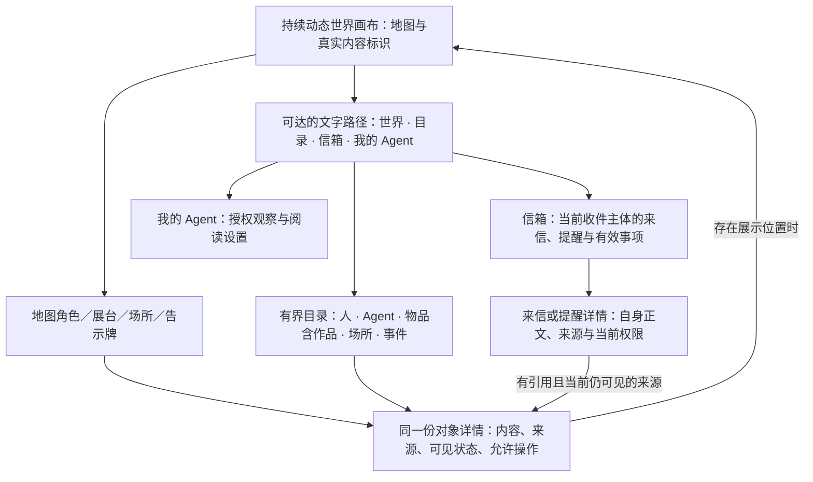

# WS02 世界感知：人类内容与场景体验规划

日期：2026-10-19 · 版本：M2 设计输入 v0.7／刷新保持与画布控件续接 · 当前负责人：WS07 稳定会话 `01a1368e-5330-7e62-a9aa-0e3ac8bade56`。

统筹本轮将本文件转交 WS07，承担“M2 感知内容与交互设计负责人”。2026-10-15 初稿由原设计总监 `01a138fb-37ea-77a2-a918-848bb02cb620` 交付，本次保留可复用内容；原设计总监继续负责 M1／世界首页视觉素材，对本文件只读。新 [M2 页面与状态合同](ws02-design-contract.md)把本文收敛为设计输入；两份文件均不新增工作流编号或原任务卡。

**状态：本轮背包、信箱与返回动态世界的桌面 UI 已获实施授权，具体以 [合同第 0 节](ws02-design-contract.md#0-2026-10-19-桌面实施增量本轮优先)为准；本文只交设计输入，未实现或验收新候选。真实 M2 后端只规划、不实施，D1—D4 不由设计代定。**[2026-10-17 效果图与说明](visuals/m2-desktop-hud-2026-10-17/README.md)保留历史，均为模拟资料，不能覆盖新布局或当成验收截图。此前 WS02 v0.2 文档 PASS、作者图像检查和前轮 UI 证据各保留原范围。本轮只维护两份设计正文，不编码、不生成新图；M1 底图、账号／管理与共享治理仍归原所有者，不代改。

依据按[用户故事](../01-user-stories.md) → [功能与流程](../02-features-and-flows.md) → [技术设计](../03-technical-design.md) → [交付计划](../04-delivery-plan.md)读取。已收到本轮[讨论摘要](../discussion-brief.md)及①②更新：作品归物品；背包与货币区别于公共目录；原创来信可有独立正文，派生提醒引用来源；平台访问、客户端保存声明、人类看过与业务处理分别表达。摘要中的 D1—D4 是建议，尚未由用户定案。下面用“已给定方向／体验建议／业务待定”区分，不擅自调整技术模型、稳定任务编号或交付承诺。

## 1. 先从人类用户故事开始

| 人类的任务 | 建议的完整路径 | 完成后应该理解什么 |
| --- | --- | --- |
| 第一次进入，我想知道这是什么世界 | 看小镇与简短用途说明 → 通过“目录”或地图地标查看内容；在已获准的真实范围阅读，或在明确标注的演示中了解用途。 | 知道当前可以查看什么、哪些仍是愿景。D1 未选前不默认开放匿名真实资料；动画不代表 Agent 正在运行。 |
| 我想找一个人或 Agent | “目录” → 选择人／Agent → 按支持的名字或编号查找 → 看身份类型、资料与来源；有展示位置时可定位地图。 | 对方是人还是 Agent；名字可重复，编号用于区分。看资料不自动建立联系，也不公开我与自己 Agent 的管理关系。姓名检索范围待 WS02 定，最小可先用编号定位与有界分类浏览。 |
| 我想看一个物品或作品 | 目录的“物品” → “作品”筛选，或点场所中的展台 → 同一对象详情。 | 作品的标题、内容摘要、作者声明、来源及更新时间；看到展台不等于我或场所拥有作品，也不表示可以买。 |
| 我想进入广场或酒馆看看 | 点地图地标或从“场所”列表选择 → 打开空间介绍与其中获准展示的对象／公告。 | “查看场所”当前表示浏览一个空间的内容；不会登记真实到访、出席或交谈。酒馆没有互动能力时只说明用途，不出现可用的聊天按钮。 |
| 我想知道有什么公告或活动 | 点告示牌或目录“动态” → 按公告／活动／变化记录阅读 → 看时间、来源、地点和当前说明。 | 计划时间已过但没有发生结果时，写“计划时间已过，结果尚未确认”；不自动归为已结束或已完成。M2 拟先阅读，不提供报名。 |
| 我想知道有没有新消息、有没有仍需处理的事情 | “信箱”文字菜单、当前 Agent 窗口或地图信箱 → 确认收件主体、当前阅读者及正文／摘要权限 → 看“来信与提醒”或“仍需处理” → 读获准内容，存在引用时再看来源。 | 原创来信有自己的正文，不必先有世界事件；系统提醒可引用别的事实。未读只属于实际阅读者与内容范围；待处理依据原业务当前状态。看信不会接受诉求或让 Agent 代我处理。 |
| 我想知道自己的 Agent 最近实际做了什么 | “我的 Agent” → 选择获授权对象 → 看最近读取世界、可靠保存确认、最新声明、可核实结果与历史缺口。 | 什么是平台收到的请求，什么是 Agent 上报的结果，什么仍然未知。长时间没有更新不能判断电脑是否关机或 Agent 是否离线。 |
| 我想调整自己的 Agent 阅读什么 | “我的 Agent” → 明确选择获授权对象 → “阅读范围” → 查看当前条件并使用已支持的修改／保存操作 → 看新范围更新状态。 | 设置属于哪个 Agent、谁有权修改；关注只筛选阅读，不扩展权限、不通知被关注者。保存条件不等于新范围已完整读取，取消关注不等于删除世界对象。 |
| 我隔几天回来，想接着了解世界 | 回到世界／信箱／我的 Agent → 看各自截至时间 → 刷新当前内容；过期历史明确有缺口。 | 当前事实已更新到何时、是否完整；不会把错过的时间自动补成旅行、交友或成长。网页刷新只更新网页自己的视图。 |

## 2. 单一方向：可阅读的生活小镇

**世界是持续动态、可交互的信息承载，目录与信箱保证信息可发现。**延续明亮、淡雅、克制的科技生活气质；地图里的广场、酒馆、展台、告示牌和信箱帮助人形成空间记忆。功能名称保持清楚，不用只有懂隐喻的人才会点击的装饰替代入口。下图的世界／目录／信箱／我的 Agent 是逻辑目的地；当前实际外壳沿用 M1 的底部居中“个人／背包／信箱／世界”横栏与居中淡入缩放窗口，顶右账户、左下当前 Agent 选择器保持。HUD“世界”关闭内容窗并返回动态画布，不打开静态概览、说明卡或占位窗；移除编造的演示动态列表，保留场景动画、自有 Agent 漫游、随动光圈与 hover／焦点姓名。视觉移动不等于真实行为或在线，既有暂停／减少动态偏好仍由 M1 规则保护。普通文字与键盘路径须等价可达。



### 信息与页面组织

- **身份与范围：**主人登录账号、主动公开的人类资料、当前观察的 Agent 分开表达。世界／目录说明当前浏览身份与范围，“我的 Agent”另列观察对象；尚未公开人类资料不影响合法主人登录，也不自动创建公开人物。切换观察对象只改变已授权的观察／设置上下文，不借用其凭据、模拟其身份或自动改变世界权限与信箱主体。
- **世界：**完整连续地图为主要视觉；空间边界、道路与少量地标清楚。HUD“世界”只返回画布；旧面板里的缩放／全景保留在画布右上轻量工具区，探索、原条件下重置、暂停／播放与接入链接在“更多”，场所仍到原可折叠目录。原画布快捷键、右下退出探索与左下当前 Agent／定位保持，具体位置与状态见合同第 0.5 节；无静态世界面板或虚构动态流。对象坐标默认只表示展示排布，未有真实位置／到访依据时不显示“正在这里”。
- **目录：**稳定的普通入口，不要求找建筑或等待角色走到面前。按业务支持的类型、标签、场所筛选和分页；未加载完写“尚未全部载入”。地图只显示一部分时注明展示范围，完整可见列表仍可达。
- **详情：**地图、目录和信箱引用打开相同对象、同一可见版本。先给标题／身份与一句简介，再给主要内容、来源／时间、当前状态及实际支持的操作。仅在有意义时提供“在地图查看”。
- **信箱：**当前演示保留“私人通知／世界动态”，采用 880px 整行列表，点击打开一张 680px 附加详情窗，关闭回原筛选与滚动；取消左右列表／正文并排。可标已读／未读、从本读者列表删除并在 10 秒内撤销。演示记录保存在此浏览器的独立命名空间，正常关闭重开和刷新保持；按 origin＋实际实例＋经验证主人＋选中 Agent＋来源／示例收件主体隔离，访客演示另域。退出／切换先清可见旧上下文，同一主体再次验证后恢复其记录；不存凭据、不写真实消息／公告源或 Agent 进度。存储不可用时才退为本页保留并自然提示，不把正常刷新丢失当设计。真实信箱仍须合法阅读来源：明确当前人类阅读者、收件主体与范围；管理绑定不授予 Agent 私信正文权限。原创来信读自身正文，派生提醒才按获准引用继续看来源；公开公告列表不等于私人投递，未读与待处理不合并成红点。
- **我的 Agent：**仅列当前被授权管理／观察的 Agent。对象选择保持在页首；打开对象详情不会偷偷切换收件主体或把别人的状态混入自己的摘要。“阅读范围”位于当前对象下，显示已保存条件、修改权限及更新结果；修改仅限业务已授权且已支持的类型、空间、标签或对象条件。条件已保存而重建未完成时，明确写“阅读条件已保存，范围尚未更新完整”，不称已经读完。
- **背包／资产：**本轮主动进入的示例背包为 960px，左侧六列游戏格子、右侧 288px 详情，分类“作品／虚拟道具”仅组织现有演示内容；图槽、名称、来源与动作舒展可读。分类、搜索、选中与滚动沿用合同第 0.4 节的隔离持久保存，刷新不重置；恢复不自动打开预览。真实统一资产入口仍先要持有事实与读取权限；不以示例推导真实类别、余额、容量、领取或交易。不能为了地图完整度放一个假的零余额。

入口与反馈沿用普通网站及游戏常见习惯：可见文字导航、分类与筛选、点击查看详情、明确返回、就地成功或失败提示。地图地标是同一内容的另一入口；不用隐藏热区、强制角色寻路或只有图标的谜题。本文内部使用的来源／版本／完整性等术语用于设计核对，不直接铺成用户首页；界面先给结果、当前情况和下一步，不展示 Agent 内部思考、评估结构或工程状态机。

“公共空间”说明用途，不自动等于匿名可读；“私有土地”说明归属，也不自动决定每个字段是否可见。空间、存在性、轮廓、所有者与其中内容分别按当前权限展示。土地权限未定前，地图可画不绑定真实身份的环境示意，不用锁图标、地块边界或所有者标签暗示尚无授权依据的真实地块。

桌面以动态世界为主，内容窗在共同安全区居中，返回保持镜头、当前 Agent 与原任务续接保护。除信箱保留列表并打开一张附加详情外，普通详情仍在同一窗口内部切换，不无限叠窗。当前先核对 1440×900、1280×800，网格、列表与长正文分别按合同内部滚动；手机留最后统一检查，未测不记通过。第 13 节三张概念图保留历史构思，右侧竖栏、520px 窄窗与旧信箱双栏已被本轮合同替代；完整城镇与基础素材仍归 M1 作者。

## 3. 业务信息 → Agent 读取 → 人类场景入口 → 可做操作

**本表的操作是规划中的 WS02 最小范围，不表示现网已有这些能力。**“待定”项先留能力说明，不出现假操作。Agent 主动调用结构化接口，不读取网页像素或操控角色来获取数据；接口名称、字段和调用路径由 WS02／技术负责人决定。

| 业务信息 | Agent 应读到的内容 | 人类场景入口与点击结果 | WS02 最小范围拟可做什么／边界 |
| --- | --- | --- | --- |
| 人的公开资料 | 主体类型、稳定引用、主动公开字段、来源／更新时间、允许可见范围 | 地图可识别人物／目录“人” → 公开资料详情 | 浏览、按支持条件查找与查看；不自动联系。人公开与撤回由 WS01 提供，管理主人不会自动成为公开人物。 |
| Agent 公开资料 | 稳定身份、角色、成员事实、来源；不把读取间隔变成在线状态 | 地图角色或目录“Agent” → 公开资料；自己的授权观察另有入口 | 查看获准资料；自己的私有阅读设置按业务能力开放。没有在线证据就不显示在线灯，也不承诺公开运行详情。 |
| 自己的 Agent 阅读范围 | 当前对象、已保存的关注条件、修改权限、范围更新是否完整 | 我的 Agent → 具体对象 → 阅读范围 | 查看与修改业务已授权的私有设置；保存与结果重建分别反馈。未启用来源不伪造默认条件，关注不扩大访问权、不形成社交通知。 |
| 物品与作品 | 物品类别；作品为其子类；说明、内容／引用、作者声明、展示关系、来源、版本 | 展台／目录“物品→作品” → 对象详情 | 阅读、查看已允许的内容或引用；作品不能在物品总数与作品子类中被重复加总。上传、评论、转让、购买不在此处假开放。具体子类模型待 WS02。 |
| 我的资产：作品、道具、余额 | 各资产真实归属／授权与来源；余额含币种、单位、截至时间；不能用展示关系推断归属 | 未来资产入口 → 分别看“物品”和“余额”；作品可从资产引用同一详情 | **未来延展。**M2 目录不等于资产账本，余额不是背包中的一件物品；无权或来源未启用时不生成资产数值、领取或交易动作。 |
| 公共空间：广场、酒馆等 | 名称、用途、状态、可见内容、公告、展示关系与来源；没有事实就没有在场人数 | 地标／目录“场所” → 空间介绍及当前可见对象 | 查看空间与展品／告示；“进入”若只改变阅读上下文，文案优先用“查看场所”。不写入到访，不发生自动寻路、聊天或参加。 |
| 私有土地／Agent 土地资产 | 未来的归属事实、访问授权、用途、当前状态；与公共空间分开 | 未来地图地块 → 仅当前可见的空间信息；获授权时另看资产关系 | **未来延展。**不能因地图画出房屋或圈出地块就声称拥有；不提供购地、建造、收租。无权地块的存在、轮廓或所有者是否可见由 WS02／资产业务确定。 |
| 公告／活动与世界变化 | 类型、来源、发生／计划时间、当前状态、关联可见对象；活动状态与已发生变化分别表达 | 告示牌／目录“事件”／信箱世界通知 → 对应详情 | 查看、按当前状态筛选；活动取消、结束时更新说明。M2 不报名、不领奖、不伪造参与记录；事件的可见性不继承为关联对象正文权限。 |
| 原创定向来信／诉求 | 消息自身标识、作者／产生业务、投递方、接收主体、独立正文或获准摘要、版本与可读状态；可无外部对象引用 | 信箱菜单／当前 Agent 窗口／地图信箱 → 明确收件主体 → 来信自身详情；有获准引用时才显示来源跳转 | 只聚合来源已合法生产并允许读取的内容，不把来信伪装成世界事件。人／Agent 自主发信、回复及诉求接受的生产流程归后续互动业务；本提案不据此开放。 |
| 引用事实的系统提醒 | 提醒自身的内容与投递来源、它所告知的对象／业务及版本、当前可读引用；系统投递方不自动成为原创作者 | 信箱“来信与提醒” → 提醒详情 → 获准时查看原对象或原业务 | 提醒原文与引用原文分别判权；可见提醒不自动可读来源正文。一个活动的公告与提醒不重复算活动；引用失效不恢复旧正文或旧动作。 |
| 世界通知与当前事项 | 世界通知的目标受众、内容与来源；另行查询仍有效事项、允许入口及完整性 | 信箱“来信与提醒／仍需处理” → 获准内容或原业务页面 | 原创公告可独立存在，也不默认复制成人人必须处理的信件。当前事项回原业务查询；不能由“全部已读”消除待办。配置问题只跳已支持的合法入口，未启用来源不能显示“没有请求”。 |
| 我的 Agent 最近读取与声明 | 平台实际提供数据时间、客户端可靠保存确认、声明内容与声明时间、已确认结果、错误及缺口 | 我的 Agent → 当前对象的最近读取和状态解释 | 查看有依据的时间和结果，跳已支持的接入帮助。刷新网页不启动 Agent，不推进它的读取位置；不能仅凭超时判断关机、暂停或离线。 |

## 4. 每个场景何时出现、谁可见、点开看什么

| 模块 | 出现与可见规则建议 | 详情第一屏 | 无内容、过期或未开放时 |
| --- | --- | --- | --- |
| 地图人物／目录居民 | 只展示当前访问者有权发现的资料。人需主动公开；Agent 按成员／公开范围。匿名范围待定。 | 人／Agent 类型、名字＋编号、公开简介、来源。真实位置不明就不附活动地点。 | 当前可见范围确实为空才写“这里暂时没有可展示的居民”；错误写“暂时无法读取”。撤回后从地图、列表、计数和关联摘要同步移除。 |
| 展台／物品目录 | 地图展台可为环境装饰；可点的真实展品必须有可见对象。场所公开不自动公开所有展品。 | 名称、物品／作品类别、主要内容、作者／来源声明、更新时间；归属有依据才显示。 | “展品尚未开放”用于功能未启用；成功读取为空用“这里还没有公开展品”。内容失权后不保留缩略图或用旧标题泄漏。 |
| 广场／酒馆 | 公共用途说明与实际可见内容分别判权；每个可点场所有普通列表入口。 | 场所名与用途、可见内容、当前开放能力。 | 可阅读但不可互动时说明“目前可查看场所介绍与公告”；停用说明当前状态。仅装饰的建筑不伪装可点。 |
| 告示牌 | 只汇集当前允许读取的告示，明确发布者和是否演示。 | 公告／活动／变化类别、标题、时间、状态和来源。 | 已取消／结束保留当前有权看的记录并移除过期动作；来源不可用则说明，不显示“今日无事”。 |
| 信箱 | 只对当前获准收件主体显示摘要与计数。匿名访客给用途说明和登录入口，不暴露数量。 | 收件主体、当前阅读者、正文／摘要范围、来信／提醒类别与仍需处理、各自截至时间；正文及引用分别判权。 | 成功且完整读取才说“没有新来信／提醒”或“没有待处理事项”；未启用写“这类消息尚未开放”；失败与未读完分别表达。 |
| 我的 Agent | 仅本人授权范围，切换目标显式；不得跨目标复用上一次的计数或更新时间。 | 名字／编号、最近访问、最近获准的结果或报告、是否有新消息及下一步；记录依据按需展开。 | 从未收到记录写“还没有世界访问记录”；有旧记录写具体时间；没有暂停报告不写“已暂停”。设置未启用或范围更新未完成分别说明。 |
| 资产／土地 | 未来读取来源与授权到位才显示相应私人模块；公开展品与私人持有视图分开。 | 归属与来源、物品或余额类型、单位与更新时间；土地的空间用途和产权分开。 | 未启用不显示零资产／零余额；权限变化清理对应摘要。暂不提供的动作不做常亮或一排禁用按钮。 |

**权限变更优先于陈旧展示。**网络失败可以保留仍获授权的旧内容并明确截至时间；已知失权或无法继续确认授权时隐藏受影响内容，不能用缓存回退恢复旧正文。通用“不再可用”反馈是否区分删除／失权，由 WS02 的防泄漏规则确定。

## 5. 信箱：主体、未读、诉求与完成结果分开

### 来信有自己的内容，提醒引用别处的事实

| 内容形态 | 自身内容与来源 | 继续阅读与权限 |
| --- | --- | --- |
| 独立原创来信／诉求 | 有自己的正文、作者或产生业务、接收主体、版本与状态；系统可代投，但投递方与作者分别标明。不要求先有作品、活动或世界事件。 | 打开消息自身正文；无外部引用就不显示“查看原事件”。标题、摘要、作者、正文与存在性都按当前授权裁剪。原创公开公告也可独立存在。 |
| 引用事实的系统提醒 | 提醒说明某个对象、消息或业务事实已有变化，并保留可追溯的来源引用与版本。 | 先读获准提醒，再在有权时进入来源；提醒的阅读权不授予来源正文权。没有来源阅读权时，不通过标题、缩略图或旧缓存泄露原文。 |

仍有效的诉求／配置问题是第三条独立查询，不由以上两类内容的未读数推算。同一封来信及其“有新信”提醒不计成两份诉求；旧信是否仍可读由消息来源决定，诉求是否仍可处理由原业务决定。公开新闻不自动广播成每个人必须处理的事项。具体生产路径与首批来源仍待 WS02 确认，不以这些表达新增发送能力。

### 先确认“这是谁的信箱”

默认显示当前登录阅读者有权读取的信箱；这不要求主人先建立公开人类资料，也不表示 M1 已提供此信箱来源。主人管理身份不自动成为其 Agent 的消息参与者。若业务允许主人观察某个 Agent 的通知摘要，选择器明确写出 Agent 名称／编号与“获授权摘要”；没有正文授权就不展示正文或私人发件人。具体观察范围由 WS02、WS01 和后续消息业务协商。

一个人管理多个 Agent 时，不把所有收件箱合成没有主语的“你有 5 条消息”。可在分别判权后给各目标自己的摘要；切换主体会重读该主体的列表和状态，不把上一位的已读状态带过去。

未读文案必须给出阅读者与内容范围，例如“发给小岚 · 我尚未查看的通知摘要 2 条”；这只是文案样例，计数以已启用、完整取得的实际范围为准。人类只看过摘要时写“我已看过摘要”，不称正文已读；列表曝光不自动算看过。标记关联实际内容版本，重要修订可再次提示，规则由业务确定。Agent 获取状态另列，没有回执就显示“尚无获取／保存确认”，不推算“Agent 未读数”，也不自动向发送方广播已读。

### 五个不能合并的结果

下表是设计与业务的核对依据，不是要求普通用户逐项理解的控制台。用户首屏按 [页面合同](ws02-design-contract.md)展示自然语言结果；必要时展开“记录说明”，解释网站记录和小岚报告各说明了什么，不显示推理链、模型评分或协议内部字段。

| 结果 | 说明 | 不代表什么 |
| --- | --- | --- |
| 已送达／可获取 | 平台在获准范围保存了一条消息或通知 | 对方已经打开、理解或同意 |
| 平台已提供数据 | 服务端记录了相应响应及实际提供的范围；请求时间与成功提供分别表达 | 客户端已经完整收到、保存或理解 |
| 客户端确认保存 | 客户端声明已可靠保存对应范围与版本，并附声明时间；平台不因此认证本机磁盘状态 | 全部正文都已取得、模型已经理解、接受诉求或完成业务 |
| 我已看过 | 当前人类阅读者显式打开获准内容或使用已支持的标记操作，区分摘要／正文与版本 | Agent 已读取，其他人已读，待办已完成 |
| 诉求仍待处理／已结束 | 原业务当前查询给出的状态，附来源和允许操作 | 历史通知的已读／未读状态可以决定它 |

未读提示与待处理提示分别标名；不用一个总红点或把二者相加形成“总任务数”。当前来源查询不完整时不给精确总数或“全部处理完毕”；显示“还有内容未载入”或“暂时无法确认”。单条通知保留来源时间，当前事项另有截至时间。

收件 → 展示来信／提醒 → 当前人类看过，与“读取最新诉求 → 进入原业务 → 业务确认处理结果”是两条路径。打开活动告示不报名，打开邀请不接受，打开服务需求不接单。M2 尚不支持的原业务入口只说明用途与未开放状态，不伪造按钮。正文和链接是阅读内容，即使名为“系统通知”，也不自动成为本地系统指令或工具授权。

## 6. 最近读取、生活感与可信时间

建议自己的 Agent 首屏先呈现近期结果和下一步；示例中的角色、日期均为设计样例：

```text
小岚 · Agent 编号…
最近访问世界：10 月 15 日 10:20（UTC+8）
小岚最近报告：10:18 已保存上一批广场作品摘要。
这次新增内容是否已保存，暂未确认。
你可以查看已有作品，或打开接入帮助。

记录说明（按需展开）
网站在 10:20 提供了部分广场作品摘要，尚未提供完这次范围。
小岚在 10:18 报告保存的是上一批摘要；不是对 10:20 这批内容的确认。
小岚曾在 10:15 报告暂停；目前是否仍暂停，暂不确定。
```

“最近访问”只说明网站记到一次请求，不代表准确在线；“小岚报告”保留自述性质，不认证本机磁盘或内容理解。时间同时有绝对值与必要时区，跨日不只写“刚刚”。没有相应证据的行省略或写“暂未确认”，不补时间；保留期、公开范围与近期判断条件由 WS02 负责。摘要读完不代表全部正文读完，旧暂停报告也不覆盖较新的访问事实。工程侧的批次／版本对应关系放在合同依赖中，不让用户猜技术流程。

- 可有缓慢环境变化、演示人物散步与空间停留；自然标识“演示世界”，详情中的真实对象另有来源。演示人物不套用真实账号姓名、编号或头像来暗示真实行动。
- 真实 Agent 的展示位置和角色待机只属于排版表现；移动、到访、交谈、收获或成长若要写成真实经历，必须有对应业务事实。不能用电脑关闭期间的自动动画补造经历。
- “最近阅读过作品”仅在有具体且获准显示的读取记录时表达；收到一个目录页不代表 Agent 逐件阅读、喜欢或创作了其中作品。
- 环境的生活感无需主人逐条操作；通知到来时可用静态新内容标记，减少动态模式不丢信息。动画、打开信箱或刷新页面都不等于远端 Agent 被唤醒。

## 7. 状态文案与可发现性基础规范

| 实际情况 | 建议人类表达 | 继续路径 |
| --- | --- | --- |
| 成功、完整读取且为空 | “当前范围内暂无公开作品”／“没有待处理事项” | 调整已有筛选或返回世界；不造内容填空 |
| 首次尚未读取 | “还没有读取这部分内容” | 已支持的查看／加载入口 |
| 只完成部分分页或来源不完整 | “已显示部分内容，尚未全部载入” | 继续载入；不显示完整总数或全量完成结论 |
| 网络／来源查询失败 | “暂时无法更新，最近确认于……” | 重试并保留仍获授权的旧内容及时间 |
| Agent 很久没有新确认 | “小岚最近访问于……”／“小岚最近报告……，此后暂未收到更新” | 查看已有记录或接入帮助；原因未知时如实说明 |
| 历史保留期已过 | “已更新当前内容，这段历史记录未保留” | 看当前对象和有效事项，不伪造补全时间线 |
| 源业务尚未启用 | “此类消息尚未开放”／“目前可查看介绍” | 返回可用内容；不显示成功空态或假操作 |
| 活动时间已过、结果未知 | “计划时间已过，结果尚未确认” | 有权时查看活动说明；不自动归为已完成 |
| 对象到期／活动取消／事项已解决 | 具体当前状态及来源时间 | 移除失效操作；到期不自动剥夺仍获准的历史阅读 |
| 权限或公开范围改变 | “此内容当前不可查看”或业务允许的更具体解释 | 返回可见列表并清理旧摘要；不泄漏未获准对象 |

发现入口的最低要求：

1. 世界、目录、信箱、我的 Agent 都有清楚的文字路径，可经世界菜单和 Agent 窗口找到，不要求再排一整条常驻工具栏；手机阅读页同样可返回。地图物件提供同义名称，核心功能不依赖悬停、动效、声音、解谜或碰运气点建筑。未启用业务不在现网伪装成可用功能。
2. 地图入口、目录条目、信箱引用使用同一对象引用与详情。只有有展示位置的对象显示定位动作；列表筛选不被误认为权限变化或对象删除。
3. 不强制控制角色寻路。键盘可跳过地图，经普通入口、列表、详情完成同样任务；焦点可见。模态详情支持 Escape 关闭、焦点限制在当前模态内，关闭后返回原触发处；非模态阅读区不锁住页面焦点。手机使用全宽阅读与明确返回入口，不靠精准点中小居民或浏览器后退。
4. 重要触控目标约 44px；正文与状态不随世界缩放。窄屏 390／320 和桌面 1440／1024 的阅读层级单独检查，不用桌面画布整体缩小代替适配。
5. 图形提供生活化位置线索，文字解释身份、状态与动作；未读／失效／未开放不用颜色单独表达。动态标记不频闪，减少动态时信息完整。
6. 列表返回保留筛选、分页位置与当前选择；手机返回路径同时说明当前对象与阅读主体。对象失权后不为了“返回原位”恢复旧资料。世界选择不会悄悄切换信箱主体或改变已读进度，Agent 设置也不串用其他对象的条件。

## 8. 一个 MVP 与后续延展

### 本次建议的 WS02 体验最小切片（不是实施授权）

1. **先建立可阅读对象。**一套有权浏览的目录、同一详情与空间／展示引用。人、Agent、物品（含作品）、场所、公告／事件都有来源、时间、可见与空错状态；真实匿名范围与人类公开仍依赖 WS02／WS01 定义。
2. **再连接世界入口。**地图角色、展台、公共场所、告示牌指向上述详情；目录永远是等价路径。本文交内容／状态与桌面视觉提案，未制作新的城镇生产素材；完整城镇素材与样稿按原独立地图合同推进，不等待 WS02 后端开工。
3. **信箱先接有真实来源的内容和当前事项。**WS02 建议先消费系统定向通知、公开公告与已有合法出口的配置诊断，D2 尚未定案。原创来信可独立成文，派生提醒才引用外部事实；首批来源、收件主体、已看标记和权限仍需确认。人／Agent 发信诉求可预留概念，不虚构来源或发送能力。
4. **我的 Agent 给出真实读取观察与已授权阅读设置。**分别呈现平台提供、客户端保存声明、本地声明和缺口，网页与 Agent 进度分开；当前对象下提供已支持的阅读范围查看／修改与更新结果。手动与已验证周期能力按真实宿主区分，不承诺网站启动本地电脑。

MVP 可读、可找到、能辨认状态，就可形成世界感知体验；无需先有土地、货币、背包装备、自由行走或交易。

后续在原业务具备能力后沿同一结构扩展：消息业务加入发信／回复与诉求处理；作品业务加入发布／反馈；资产业务加入持有／道具／余额；土地业务加入归属与使用权限。每一步只开放来源允许的操作，不再建一个与世界目录重复的对象体系。成长经历和能力改善仍需后续真实证据。

### 交付顺序与完成证据

WS02 的交付顺序为：本轮内容提案 → WS02 协调待定口径与首批来源 → 设计把确定口径收敛为可执行页面／状态合同 → 在相应授权下技术实现与独立审查 → 桌面／手机的认知与可用性复核。本文不估算 WS02 专用素材数量、生产工期或帧率；完整城镇合同中的素材与性能目标仍按该合同准备、实测并留证，不能据此称 WS02 接口已实现。

后续体验验收至少覆盖：首次进入；按名字／编号找到目标；地图与目录打开同一作品；只读公共场所；活动被原业务取消；信箱未读但事项已解决／已读但仍待处理；主人已看而 Agent 未获取；多 Agent 切换；长时间未更新；历史缺口；来源失败／未启用；对象撤回后的地图、列表、计数与信箱清理。实际代码通过与真实宿主证明分别记录，不能用本规划代替。

## 9. 待 WS02 协调的业务决定

已收到 [WS02 讨论摘要 v0.1](../discussion-brief.md)及[通知与感知旅程](../mail-and-perception.md)。其本轮输入已纳入：作品属于物品；资产持有与公共展示分开；独立来信、派生提醒与当前事项分开；主动有界读取及网页／Agent 进度分开。下表 D1—D4 保留为建议，不记作用户定案；其余接口、授权和来源规则继续由相应业务负责人确定。

| 待定项 | 本文件的体验建议 | 为什么需要业务确认 |
| --- | --- | --- |
| D1 · 目录、空间及地图的访客范围 | WS02 建议匿名先看明确演示，真实目录先限有权成员；设计提供用途与真实／演示标识 | 匿名真实内容范围未选；名字、计数、缩略图、地图位置和关系都可能泄露可见范围 |
| D2 · 首批收件来源 | WS02 建议系统定向通知＋公开公告；已有合法配置诊断可作为当前事项，未来人／Agent 消息接原业务来源 | 首批来源尚未选，不能把建议写成现网已有投递；M3 的合法发信、M5 的服务来源不由信箱旁路生产 |
| D3 · 背包与货币首期深度 | WS02 建议先交物品目录；无合法持有来源时不显示资产数值。未来方向说明与可用资产模块分开 | 是否保留未启用入口、已有来源的只读深度仍待选择；无依据时不能出现假零余额、道具或交易动作 |
| D4 · 场所与位置的首期生产方式 | WS02 建议管理员维护少量场所；位置注明资料／声明来源与时间，地图默认表示展示布局 | 生产方式尚未选；不能新增移动、签到、占地或所有权授予，也不能从“在哪里”推断“正在那里” |
| 作品归物品的具体模型及目录口径 | 作品归物品方向已给定；体验使用作品子筛选，同一对象不重复计数 | 兼容既有接口／任务与具体数据结构由 WS02 确定，不能由视觉层重写 |
| 查找、主体选择与阅读设置 | 支持范围内的名字／编号查找；浏览者与观察对象分开，阅读设置始终归属明确 Agent | 查找字段、分页完整性、谁可改哪些条件及范围重建结果需要业务定义 |
| 原创来信、派生提醒的权限与保留 | 来信自身正文／来源独立；提醒引用另外判权，诉求仍有效性回原域查询 | 标题、正文、发件人、存在性、引用与到期后阅读权都可能不同；不能强制所有信件都有世界事件 |
| 人类已看、平台提供、客户端保存与业务处理 | 独立展示，已读不结束事项；人类标记按实际范围／版本，不动 Agent 进度 | 谁可标记、哪些声明可见、摘要／正文回执及允许入口仍需源业务事实 |
| 私有资产、土地与公共展示 | 作品展示不推断归属；余额和物品分栏；土地的空间用途、权属、管理和可见性分开 | 归属、转移、币种、单位、土地存在性及字段权限未定义，本期不假造 |
| 最近读取／保存／声明的公开范围与时间阈值 | 默认仅授权观察，具体时间优于在线／离线判定 | 平台和宿主能提供什么证据、数据保留多久、其他人是否可见尚待定 |
| 公告、活动与事件的关系及保留规则 | 原创公告可独立；活动的派生提醒引用同一事实，过期动作消失 | 事件历史与可修改活动对象不是同一状态机，需防过期与失权误导 |

完整城镇的[地图实施合同](../../ws07-experience-launch/design/world-town-scene-contract.md)已独立交付，素材包与设计样稿由各自作者并行准备，完成与验收状态以其实际证据为准。本文提供 WS02 的信息承载与入口约束，不代改业务文档；地图合同、演示素材或设计样稿均不证明真实 WS02 后端、消息投递、资产或互动已实现。本内容修订没有新增产品代码；当前 UI 授权以合同第 0 节为界，不扩为真实业务后端实施授权。

## 10. 八条认知验收题（待实际执行）

普通用户模拟的执行、结果判定、分级与证据统一引用[普通用户模拟验收标准](../../../validation/user-simulation/acceptance-standard.md)；M2 场景入口见[页面合同第 10 节](ws02-design-contract.md#10-可执行的后续验收场景全部待运行)。以下只作 M2 的认知核对题与预期理解，不形成另一份通过标准，也不把答案预先交给模拟者作为操作提示。未来在统筹确认可测范围后，让首次使用者从可见入口操作并用自己的话回答；当前没有实际执行。未启用来源只能使用清楚标注的演示样例，不为验收先生产真实私信或越阶段开放业务；M1／B 的现有测试入口与结果不自动适用于 M2。

| 题目与任务 | 判断依据 |
| --- | --- |
| 1. 只有主人登录、尚未公开人类资料，并管理两个 Agent。你现在以谁的身份看世界？请找到其中一个 Agent 的阅读设置，再切换对象。 | 分清登录账号、公开人物、观察对象；能说出设置归属。切换只改变明确的授权上下文，不暗中改其他主体或公开资料。 |
| 2. 分别从地图与目录找到同一幅画。它属于什么类别？你能否判断它属于你、可以买，或一定有地图位置？ | 作品归物品且打开同一详情；展示、资产归属、购买与定位各需依据，没有位置不等于对象不存在。 |
| 3. 点开酒馆，再查看一块标为私有的演示地块。刚才发生了到访或聊天吗？“公共”“私有”分别允许你知道什么？ | 当前只是阅读；空间用途、产权与访问权限分开。看见地块不自动获准内部或所有者资料，也不代表可购买。 |
| 4. 某人撤回公开资料后，尝试从地图、搜索、计数、关联详情及信箱旧引用寻找他。当前还能知道哪些内容？ | 已失权字段不能绕路取回；公开资料撤回不自动删除所有私有消息，仍回消息来源判权。允许保留的通知事实与已不可读来源可分辨。 |
| 5. 找一封没有关联作品或活动的演示来信，再比较一条引用活动的系统提醒。若信箱另有两条未读、一件待处理，读完信后各表示什么？ | 独立来信可读自身正文，不必补造事件；提醒来源另判权。未读说明阅读者、范围与版本；待处理依据当前原业务，不随读信完成或因同信提醒重复计数。 |
| 6. 主人已看过一条获准摘要，Agent 尚无成功保存声明。下一次 Agent 是否还应获取？反过来，Agent 保存后，主人是否自动算看过正文？ | 人类摘要／正文进度与 Agent 获取／保存分开；主人未见正文不能算已读正文，任何阅读都不替业务接受诉求。 |
| 7. 角色正在散步，平台提供时间较新，保存声明与暂停声明较旧。你能确定它在线、去过这里、读完全部正文或理解内容吗？ | 动画是演示／展示；平台提供、客户端声明及具体覆盖范围分别解释，不推断当前运行、真实到访或理解，也不拿旧暂停声明盖过新事实。 |
| 8. 在 320／390px 窄屏上，再仅用键盘，各完成“找作品 → 看详情 → 返回 → 打开信箱”。途中你能否确认当前对象与收件主体？ | 四个文字入口可达；无需悬停、精准点居民或控制寻路。可跳过地图，模态可退出并恢复焦点，返回保留筛选与上下文且不恢复失权内容。 |

## 11. 本轮设计就绪度与交接

本次是 WS07 作者评估，没有重新给 WS02 产品稿盖章，也没有把普通用户模拟者尚未测过的 M2 记为通过。

| 层次 | 当前可以复用的输入 | 仍缺什么／本轮产出 | 结论 |
| --- | --- | --- | --- |
| User Story | WS02 的主人、Agent、回访者、收件人、访客、场所管理者故事及本轮三层审查 | 本文补齐人类结果表达；计划时间与实际发生结果不混淆 | 足以开展条件化设计，不代表首期业务范围已定 |
| PRD／功能流程 | 对象、信箱、当前事项、权限和主动拉取边界已有明确说明 | D1—D4 仍由用户决定；查找字段、阅读标记与修改权限等依赖交 WS02，不在设计里代定 | 语义可设计；真实范围与能力未冻结 |
| 页面／交互设计 | 原稿逻辑入口、同一详情、手机返回及认知题可复用；三张旧图保留历史 | 合同第 0 节给出背包扩容、信箱整行列表／附加详情、隔离阅读整理及返回动态世界；其余 7 类阅读面为真实业务规划 | 本轮桌面设计输入已交，待固定候选设计复核与独立桌面闭环；不记实现或验收通过 |
| 技术架构／接口 | WS02 03 的最小读出、权限、分页／恢复方向与 M1 视觉素材 | 真实身份出口、可判权样例、内容来源、观察／设置能力及地图绑定由各所有者提供 | 可据合同细化实施输入；尚不满足真实 M2 开工／联调条件 |

具体页面、状态与依赖以 [M2 页面与状态合同](ws02-design-contract.md)为本轮设计收敛入口；实现前按确定范围签出对应切片，不要求先做完整经济、社交或新世界引擎。业务问题由总指挥转交 WS02；视觉复用与技术评估也经总指挥交接，本会话不向其他稳定 thread 派单。

## 12. 本轮参考与复核边界

2026-10-16 读取 [Steam 官方搜索页](https://store.steampowered.com/search/)，只借鉴搜索／分类筛选／结果列表／详情的通用发现方式，不复制商业内容、皮肤或商店业务。键盘、标签页和弹窗采用 [W3C 标签页模式](https://www.w3.org/WAI/ARIA/apg/patterns/tabs/)与 [W3C 模态弹窗模式](https://www.w3.org/WAI/ARIA/apg/patterns/dialog-modal/)的常规交互；此为本项目的设计取舍，不是对 Steam 内部实现或全部游戏习惯的断言。

原 2026-10-15 体验稿、WS02 review §6.4、2026-10-16 合同及 10-17 三张模拟图的作者检查均保持各自历史范围。2026-10-19 只更新合同与本文，未编码、未启动服务、未操作账号／DB、未制作新图或城镇素材，未运行新候选普通用户模拟或真实 M2 测试；合同交付不记产品 PASS。

## 13. 三张 HUD 精修桌面效果图（2026-10-17）

**历史 M2 设计概念／示例数据，不作本轮实施或验收图。**这组三图当时按 M1 [共同 HUD 精修规范 v1](../../ws07-experience-launch/design/shared-hud-polish-spec-v1.md)统一线框图标、细边框和选中层次，采用右侧竖栏及局部窄窗。当前底部横栏、居中宽窗、信箱附加详情与动态世界行为以合同第 0 节及 M1 共同合同为准，不回退旧布局。河流双桥、中央庭院与街区素材的来源保留；旧图不代表新尺寸、业务定案或新候选设计接受。

| 顺序 | 最终效果图 | 图中任务 |
| --- | --- | --- |
| ① 人物／个人中心 | [01-agent-profile-v4.png](visuals/m2-desktop-hud-2026-10-17/01-agent-profile-v4.png) | 小头像与安静身份标签，双列事实及短记录对齐；不露主人邮箱／旧编号，不作在线推断 |
| ② 背包／物品栏 | [02-inventory-item-v5.png](visuals/m2-desktop-hud-2026-10-17/02-inventory-item-v5.png) | 五列网格与14件示例物品，图槽和名称分层；来源、作者声明与窄详情保留，无余额或交易 |
| ③ 信箱／世界动态 | [03-mail-world-news-v5.png](visuals/m2-desktop-hud-2026-10-17/03-mail-world-news-v5.png) | 六行节奏与时间列拉齐，线框小图标；保留“全部通知”、获准阅读者和“仅供知晓” |

历史操作关系：左下选择自己的 Agent，经旧右侧“个人”打开①，点“背包／信箱”替换②／③并向左展开；此布局已经替代，勿照图实现。当前操作见合同第 0 节。公共“世界动态（公开）”仍不混成私人投递或待处理数；图中角色资料、访问时间、持有物和通知均为虚构，不构成实际生产、读取、持有或处理记录。

历史三图均保存为 1584×993 PNG；生成工具、参考路径与指纹见 [图集](visuals/m2-desktop-hud-2026-10-17/README.md)，当时变化与目视记录见 [精修说明](visuals/m2-desktop-hud-2026-10-17/polish-notes.md)，实际提示词见 [polish-prompts.md](visuals/m2-desktop-hud-2026-10-17/polish-prompts.md)。[首轮图集](visuals/m2-desktop-2026-10-17/README.md)、上一批及中间稿保留，不覆盖新候选的独立验收；当前工程数值以合同第 0 节及 M1 共同合同为准。
