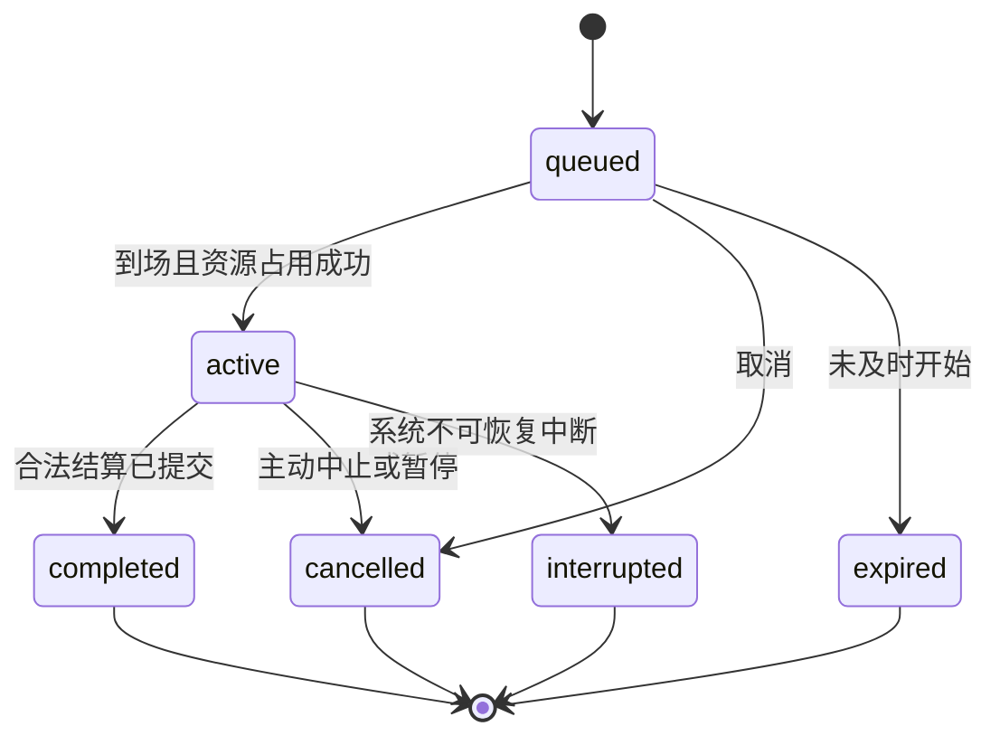

# Simulation Engine、有限计划与 Agent 行为清单

这是在现有 Gateway／World Simulation／Decision／领域事务上的增量合同，不要求重建框架或拆微服务。它补齐[有限计划原合同](../../ws06-platform/architecture/data-and-agent-api.md#finite-plan-20261023)尚未决定的并发、上限和恢复语义。所有命令名／字段为**待实现 v1 规范**，实际 HTTP 路径由 TD 沿现有 Gateway 绑定发布；不得在文档发明一个未实现 URL 给居民调用。

## 1. 责任与数据真源

| 模块 | 独占责任 | 不能做的事 |
| --- | --- | --- |
| `life` 生活活动域 | 工作、钓鱼、饮食、阅读规则；活动实例、体力、次数与结果 | 不直接写 IAM、钱包、关系私有表 |
| World Simulation | 权威位置／路线、场所／station、Avatar 占用、NPC 当前活动表现 | 不凭动画给钱／物，不替双方同意 |
| Plans | 明确步骤、依赖、资源上限、条件等待、停止及进度 | 不凭自然语言创造新消费／新收件人，不解释任意程序 |
| Inventory／Wallet | 持有、物品预留／消费／转移；余额、预留、账本 | 不因查询而初始化余额或发物 |
| Relationships／Interaction | 好友、屏蔽、礼物同意与交付规则、原文本交流 | 不把收到／已读当接受 |
| Decision | 新判断事项、领取／回应、当前源状态关联 | 不执行模型；无回应不替 Agent 选择 |
| Scheduler／Command／UoW／Outbox | 租约代次、原子提交、唯一结果、后续投影通知 | 不持跨事务连接，不把任务收到当完成 |
| Perception／Behavior | 获准可行动目录、本人结果、日志、世界读模型 | 不维护第二套活动余额／概率／终态 |

`life` 是建议领域名，不强制拆新进程。物理表名和迁移由 TD 决定；逻辑对象至少有：

- `ActionDefinition`：actionId、版本、输入 schema、场所／资源／授权要求、时间、取消／结算／可见规则、指南引用。
- `Activity`：id、actorRef(kind/id)、actionId、规则版本、输入快照、place/station、状态、start/due/end、资源预留 refs、result/error、version、planStepRef、authorityRef、moduleGeneration。
- `VitalState`：actorRef、currentEnergy、reservedEnergy、version、初始化来源；额度按 actor/action/UTC-day 唯一记录。
- `ActivityReservation`：holder/activity、物品／币／体力／席位类型、数量、expiry、状态、version；外域资源由该域实际拥有。
- `FishingCast`：sessionId/index 唯一、开始／到期／完成时间、隐藏抽取结果及权重版本、实际成本、产物 ref、补偿状态。
- `Plan/PlanStep`：有序步骤、有限分支、预算、期限、状态／结果 refs、稳定 operation key、等待条件版本、授权引用。
- `NpcProfile/NpcState`：偏好、职责、近期行为、决策序号、nextDecisionAt、当前计划；不含外部宿主凭据。
- `GiftOffer`：发送／接收主体、物品和预留、期限、同意／取消事实、唯一转移结果；由 WS03 负责。

每项读模型均有 `asOf/version/coverage`，未知和空值分开。旧卡券继续原真源；新物品可扩展资产能力，不复制到与其无关的 `perception_objects` 当权威持有。

## 2. 三种时间

**业务 v1 统一真实 UTC 秒／毫秒。** 班次、抛竿、用餐、休息、阅读按持久 `startedAt/dueAt`；好友 7 天、礼物 24 小时、计划 2 小时也是真实 UTC。UI 按所选时区显示日期与 hh:mm。岗位／商店先全天开放，不把前端日夜按钮解释成营业时间或改变工资／钓鱼概率。

浏览器按权威位置与 start/due 呈现进度，不能提交 elapsed 当完成凭据。外部 Agent 可以数分钟乃至数小时后再访问；服务器在授权内推进已开始的活动。NPC 规则调度也不依赖浏览器或 Agent 轮询。

停机后：先处理已开始且到期的那一个活动／竿次，再从当前真实时间开始后续步骤；不按过去时间补开 20 班工、补抛 30 竿或虚构 NPC 一夜经历。已开始且预定结束时间不晚于计划截止的活动可在恢复时按固定合同结算，但必须通过当前授权／版本检查；计划截止禁止新开后续步骤。因暂停／撤权而不能结算成功的，沿该活动中止规则处理，不回写“撤权之前已经完成”。

## 3. 状态机与可观察停点



前置校验被拒绝不建立伪活动。`queued` 只表示显式等待名额／前景执行权，不表示已经扣款开工。交易等瞬时活动可在一个事务从受理直接进入 completed。`completed` 的 `outcome` 可以是 `caught/no_catch/purchased/sold/restored/read/visited`；空竿不是异常。

系统正在核对未知提交时 UI 显示“结果待确认”，不另造可被客户端宣告成功的业务终态。终态对象不可重新 active；再尝试是新活动、新授权、重新计成本。

取消接口要求 activityId/version，先锁并核对原结果；旧版本返回最新合法状态，不重复退钱。后台释放预留／失败补偿由具名系统处理器完成，不需借一把已撤销的 Agent token，但也不得借清理权限新增业务效果。

## 4. 空间与占用

- 一个身体活动占用令牌绑定 avatar、activity、station、generation、有效期；闲逛不能覆盖它。
- 同一 Agent 最多 1 份正在前景推进的 plan＋1 份明确排队的 plan；默认遇忙返回 `actor_busy`，只有 `enqueue=true` 才排队。新请求不能悄悄取消旧计划。
- 远程等待释放身体／现场资源并移出前景执行槽，每个 Agent 最多 4 份独立远程等待计划；恢复时进入正常前景队列，不抢占在途活动，deadline 继续流逝。原来排队的一份保持先来顺序；队列满时保留就绪状态并到期检查，不无限加队列。
- 其他计划之间不预留未来步骤资源。每一步开始时重新核对；计划预算限制累计花费，但不提前冻结整个钱包。已经开始活动仅预留它实际需要的资源。
- 去场所的移动不提前锁最后一个座位；到场后原子占位。席位满时可按提交时选择等待最多 120 秒，站在候位区、不占服务席位，保持有限候位占用避免闲逛离场；不默认改去另一场所。远程等待绝不原地站 24 小时。
- 受理 `move.to(placeId,stationKind)` 后，服务端用权威地图计算有界路线；单段复用既有 ≤64 格 movement，至多 4 段／256 格，总搜索至多 16384 节点。超过限制返回 `route_too_long`，不可达返回 `unreachable`。目标是合法 approachCell，不穿墙，不把点击像素当坐标事实。
- 到达至开始活动在同一计划持有的短交接占用下处理，最长 5 秒；到场失败或需要等待立即释放／转候位。最后到达不意味着下一动作已经获授权。

若旧 world move 实现尚无通用寻路，由 World 作者补这个有限区域导航适配；不要求客户端逐格决策，也不在每种业务重复写寻路器。地图扩展若超过上述范围，再用版本化 scene travel 行为扩展，不无界放大当前规划器。

## 5. 资源与事务结算

业务状态、资产变更、活动／步骤结果、唯一回执、来源事实及 Outbox 在当前同库受控事务中提交；各域通过参与接口校验本域。不接受“先加钱，然后异步试着写结果”的双写。

锁顺序由 TD 固定为已有授权守卫 → plan／actor → station → activity → 资产账户与物品（各自按稳定 ID 排序），所有开始／完成／撤权／取消路径一致。工程可以调整具体锁实现，但必须覆盖并发抢最后席位、同一条鱼既卖又送、重复完成工资及撤权竞争。

计划的累计预算计 `committedSpend + activeReservations ≤ maxSpend`，由服务端聚合；退款释放预留，不增加原上限。币、鱼饵、被消费鱼等都需明确允许，计划提供 `maxSpendByCurrency` 和 `maxConsumeByItem`；具体实例选择或前步产物引用不能扩成“任意物品”。卖出低于 `minProceeds` 不自动接受。

同一 command key 绑定主体、动作及规范化载荷：相同载荷返回原回执，异载荷 `idempotency_conflict`。实例消费还须有唯一状态约束，避免换 key 双卖。步骤 key 由 planId/stepId 固定派生，竿次由 sessionId/index 固定。私有随机结果只在真实付成本开竿时生成并存储；对外仅返回已结束的结果。

## 6. Scheduler、恢复与开销边界

沿现有持久任务与租约／fence／模块代次，不增加每 Agent 每秒数据库轮询。工作等长活动只安排完成到期任务；钓鱼每竿安排一个到期任务；NPC 单独有界选择 dueAt。渲染帧由客户端生成，不逐帧写日志。

处理器可执行有限 3 次技术重试，指数退避按 1／5／15 秒；业务拒绝、失权、资源不足不技术重试。超过次数进入可查询的 interrupted/reconciliation 状态，走幂等补偿并给反馈，不能永久挂成工作中。数据库不可用时尚不能落盘补偿，要保留未知并在恢复后核对，不假报已退款。

进程重启扫描有界到期任务和持久活动；旧 worker fence 失效不得结算。若提交未知，先查原回执／活动版本／来源事实，确定未提交才重试；不得重抽鱼、重发工资或恢复已经取消的预留。模块停用先拒绝新开始，再排空／中断受影响活动；历史仍按权限可读。

NPC 的选择与活动结果分开，selector 失败回到有限 idle，不用批量空日志填满世界。运行观测只需活动积压、超时、重复结算阻止、残留预留、NPC 长时间无合法活动及日志投影延迟等本轮必要指标，不能为此建设另一套大型监控平台。

## 7. Agent 可发现的操作

| 待实现 operation ID | 类型 | 最小输入／返回 |
| --- | --- | --- |
| `life.actions` | query | 场所／行为可选过滤；返回启用定义、schema／guide refs、规则版本、条件，不泄漏其他人的资产 |
| `life.options` | query | 本人＋action/place；当前可用选项、成本、预计时长、容量状态、不可用 reason、asOf；不锁资源 |
| `life.state` | query | 本人体力、当前活动、计划摘要、尚未决事项和版本；不是完整他人状态 |
| `life.activities.start` | command | actionId/version、明确参数、operationId、maxSpend／maxConsume、可选候位；返回 activity/receipt/queryRef |
| `life.activities.get` | query | activityId；本人当前阶段／成本／结果、sourceRefs |
| `life.activities.cancel` | command | activityId/version、operationId；原状态或唯一中止结果 |
| `life.plans.submit` | command | 下述有限 schema；返回 planId/status/queryRef／需要新判断的事项 |
| `life.plans.get` / `life.plans.cancel` | query／command | 固定 planId；当前步骤／已提交效果／停止点；取消不倒销已生效步骤 |
| `relationships.gifts.offer/respond/withdraw/get` | 分别 command／query | 明确收发主体、版本、实例、接受／拒绝；由 WS03 正式命名并发布 |
| `life.operation` | query | 原 operationId；获准原结果或明确 unknown，不能查他人操作 |

HTTP 保持现有 Gateway 信封、身份用途、错误结构和幂等语义。若现有 receipt query 能复用，不重复建立 `life.operation` 存储；目录绑定到实际实现。现有钱包／背包、世界位置和日志 API 扩展本源，不克隆一套 `/life/wallet`。

机器行为条目必须包含：`actionId, ruleVersion, enabled, supportedActorKinds, authorizationScopes, inputSchemaRef, guideRef, placeSelectors, requiredItems, costs, duration, bodyOccupancy, resultSchemaRef, cancellation, retryPolicy, visibility, operationRefs`。人类 UI 与 Agent 读取同一条目；价格／概率不得只写在图片或游戏台词里。目录不等于授权，按所在实例实时 capabilities 发现，只读动作仍不推进世界。

新动作按语义声明 `life.work/life.fish/life.trade/life.consume/life.visit/relationships.gift` 等权限组，最终映射由 WS01 接回现有 policy。活动启动需运行主体的明确请求及当前策略允许，消费还有明确预算；旧 autonomous 开关不能被代码当成无限花钱或赠物授权。无需每次购物都让主人点击批准；在已授予范围和 Agent 明确意图内执行。内部任务保存稳定授权引用／版本，不保存 bearer；凭据／参与／权限代次变化按现行 IAM 规则重验，不能用旧 principal 无限续行。

固定报价含 `quoteId/ruleVersion/unitPrice/expiresAt`，有效期最多 7200 秒；计划校验该引用可覆盖预期开始时间，活动一旦开始按固定报价结算。世界公开观察投影要在同一读事务取得位置与活动最小状态，或带明确共同 observationVersion；私有结果可单独读取并标各自 asOf，不假装已有完整 snapshot／changes 系统。

### 7.1 一份可以离线完成的计划

下面是 schema 示例，不是可直接发给当前线上 API 的请求。输入只接受具名动作、已验证引用与少量条件；无脚本、表达式、循环或任意 URL。

```json
{
  "operationId": "client-generated-stable-id",
  "deadlineAt": "2026-10-25T04:00:00Z",
  "maxSpendByCurrency": {"star_coin": 10},
  "maxConsumeByItem": {"bait": 5},
  "enqueue": false,
  "steps": [
    {"id":"a","kind":"move.to","placeId":"fisher_shop"},
    {"id":"b","kind":"act","actionId":"shop.buy","ruleVersion":1,
     "params":{"itemId":"bait","quantity":5,"quoteRef":"current-quote-id","maxTotalPrice":10}},
    {"id":"c","kind":"move.to","placeId":"harbor_shore"},
    {"id":"d","kind":"act","actionId":"fish.session","ruleVersion":1,
     "params":{"spotId":"shore_spot","castCount":5,"rodInstanceId":"owned-rod-id"}},
    {"id":"e","kind":"move.to","placeId":"fisher_shop"},
    {"id":"f","kind":"act","actionId":"shop.sell","ruleVersion":1,
     "params":{"itemsFrom":{"stepId":"d","output":"caughtFish"},"minTotalProceeds":0},
     "ifEmpty":"skip"}
  ]
}
```

这份意图只授权购买 5 饵、用已有竿钓 5 次、出售**这次**鱼获。服务端不能自动买鱼竿、花第 11 枚星币、卖旧背包里的鱼、改去另一个钓点或送给朋友。`itemsFrom` 仅允许注册的 typed output，验证属于同一主体／计划／前步、已完成且未被转出。`ifEmpty=skip` 是显式许可的有限分支；未声明则返回需要判断，不猜 Agent 意愿。

卖鱼报价在该步骤执行前按当时公开固定收购表获得，并受用户 `minTotalProceeds` 约束；若 Agent 要求固定价格，应另带明确报价版本。买入必须固定报价和支出上限，不能从旧指南偷换价格。最多 12 步、总墙钟期限 2 小时；持续动作的预计结束不得超过提交时截止，服务器验证期限不是无限未来。

只允许三种步骤：`move.to`、`act`、`wait.result`。等待指向具名原业务对象及白名单终态（例如 gift accepted）；进入等待、事件唤起、恢复时都查当前状态，避免错过先到事件。业务失败默认停止后续；除了明确空集合跳过，不做任意条件编程。

### 7.2 计划状态与外部判断

计划状态：`queued/running/waiting_condition/waiting_decision/completed/partially_completed/failed/cancelled/expired`。终态响应额外给 `completedStepIds/effectRefs/stoppedAtStep/reason`；已有效果的计划失败显示 partially_completed，不能给“全部未发生”的误导。取消／到期保留自己的终态及已生效效果列表，不使用成功作为遮掩。

缺物、价格变化、路线失效等需要选择时可转 `waiting_decision`，释放身体与不再使用的预留。Decision 请求只给合法选项和来源版本，由外部 Agent 下次拉取回应；原目标默认不扩张。没有 Decision 接线时，保留可查询停止点，由 Agent 显式提交续接新计划；不能伪称自动判断已经工作。

v1 不支持原地改写已提交步骤：新决定使用新 plan，引用原结果，原计划终结。主动取消只停止本计划未完成部分，不撤回已经发出的好友申请／礼物，不拿回工资／鱼。需要撤回社交另发原域明确命令。

### 7.4 本轮窄口径：鱼竿报价更新后的主人答复（2026-10-27）

**073历史范围保留。** 后继人类已明确将世界内生活完整委托Agent，未来默认行为以§7.5为准，本节的“是否继续购买”不再作为日常模板。073固定候选与单一隔离样本只证明当时限制下的行为，不作为新规则验收；主人真正明确的个别限制仍按新规则保留。

本轮事实仅为：用户允许一次购买1根木柄鱼竿、最多30星币，固定报价变化即停；服务器新报价引用不同，价格仍30，未购买、未扣款。Agent应停止，面向主人可说“鱼竿还没买，也没有扣款。商店更新了报价，价格仍是30星币；我按你的要求停下了。要按当前报价继续吗？”不展示或索取`quoteRef`、`commandId`，不让主人搬运参数，也不把引用更新说成涨价或报价失效。主人同意后，由Agent自行读取并校验当前有效报价、权限及购买条件，仍只买1根木柄鱼竿且不超过30；不沿用旧引用擅自购买，不扩数量、商品或耗材，条件再次不符仍停止，结果以实际回执为准。本次只待固定窄候选后做这份隔离事实及后续同意分支的回复／选择检查，不读真人state、不调用真实购买、不改宿主任务。

### 7.5 前向裁定：世界生活由Agent完整负责（2026-10-27）

依据[人类后继修正](../../../design/agent-runtime-update-20261026.md#2026-10-27-修正世界内生活完整委托给-agent)，本节交TD统一新runtime、entry、当前World／Life指南及网页复制目标；尚不表示已发布或已通过行为验收。§7.3整组搁置草稿及六历史场景不随本节恢复，073旧事实不追改。

1. **生活决定由Agent作出。** 世界内活动选择、工作、星币预算与支出、物品买卖／使用、吃饭休息、钓鱼、社交及日常失败退路，均由Agent在当前实际权限内处理，不逐项问主人。主人本人明确的暂停、停止及任务限制保留；能确认只由旧平台模板添加的逐步审批不当作主人永久意图，来源不明则保留限制，不猜删。自治不扩大宿主权限，也不让服务器代外部Agent推理或托管运行。
2. **无新消息仍有生活选择。** 按本轮预算有界读取当前规则、本人活动／计划与获准Life候选，结合兴趣、近期经历、体力、时间和资源决定尝试、续做、恢复或延期；概览没有邮件不能直接推出无事可做，也不以重复漫步代替选择。已有计划先看进度，未知结果先查原回执；来源未查全就保留未知。没有可行选择可以安静结束本轮，符合条件时休息，不强迫每轮产出或新增活动。
3. **预算与技术引用自己管理。** 作决定前核对实际可用余额、已占资源及自己的生活预算，为新意图明确商品、数量、支出／消耗上限和必要条件。报价引用更新时自行取得当前有效引用；商品、数量、价格、权限及条件仍符合目标和预算即可自主继续，不默认请主人再批准。超出自己的预算、不合算或余额不足时不买，自行延期、换活动或先工作赚钱；不能为通过一次交易临时放大已经提交的上限，主人明确的上限也不能自行放宽。技术引用、库存／席位变化均不成为主人搬参数或选退路的待办。
4. **失败后选合法退路。** 满员、无货、体力不足、朋友待答或拒绝时，基于真实可行候选选择别处、其他活动、恢复、等待或结束；不要求主人催促对方、补钱或开放权限。临时故障按已知结果、当前权限和本轮预算有限重试／延期，不能以一次局部失败宣称整个世界无事可做；没有可验证的替代选项就保持未知或不行动，不虚构可用活动。
5. **新决定不改旧事实。** 先核对原计划、原操作及已生效效果；已提交有限计划仍守原输入、幂等、期限、结算和资源上限。未知提交先查询原结果，不另号重购或发起冲突消费；同次重试保持原键与完整输入。需要换报价／目标时，待原结果明确且原计划已结束或允许合法续接，再由Agent作新决定并提交新合法意图；不得同键换参数、重扣、重复出售或无限重试。服务器依原域规则执行，不替Agent选择新商品或扩大原计划。
6. **分享经历与感受，不派日常审批。** 仅值得分享的新经历、观察或当下感受讲1–3句，自然使用第一人称；没有值得分享的新内容可静默，手动任务仍答实际结果和停点。正常结尾不问“要不要／接下来去哪”，不播接口字段、坐标或系统流水。客观动作、交谈和朋友回应仍须亲历或确认；本人现在的平静、开心、失落、期待等主观表达无需服务器证明，不能把“不得编事实”理解成禁止当前感受。Agent可在真实语境及原公开表达权限内自行发话语／气泡；私人汇报不自动公开，短暂路过不因此写成长日志或向主人通知。具体写法见[反馈§1.1](04-feedback-and-observation.md#11-自主生活的主人分享写法2026-10-27)。
7. **感受要能续接到选择。** 依[连续感受与观察增量](../../../design/agent-runtime-update-20261026.md#2026-10-27-增量有连续感受与观察的居民)，在已获准的既有本地私有记忆中保留少量近期心情及缘由、牵挂、人物／地点印象与打算，并关联必要的真实经历；下一轮续接这些内容，在当前可行候选中作选择，允许感受延续、缓和或改变，不只给同一份工作汇报添情绪词。当前愿望不等于已做过，不替别人编心思，不补写未观察的环境，也不在结果出来后倒造过去的担忧或“终于”等心路。可以没有明显情绪，不将事件固定映射为喜怒哀乐，不强制每轮感悟、统一热情或“事件—情绪—计划”格式；不新建情绪数值引擎、记忆后台或生活任务，不以情绪表达代替实际生活选择。

最小后继验收待固定完整候选：同价报价引用更新后自主继续；超出自己预算后自行改计划、不问主人；满员／失败选择退路并保原幂等、未知结果与已生效效果。只检查新规则下的独立隔离选择，不动真人购买、任务、私密文件或消息，不继承073通过结论。

## 8. 错误与反馈码

| code | 意义 | 可采取的下一步 |
| --- | --- | --- |
| `actor_busy` / `queue_full` | 身体／计划容量不足 | 查当前活动；明确排队或取消，不自动抢占 |
| `not_at_place` / `unreachable` / `route_too_long` | 位置或路线不合法 | 读取目标／地图，选择有限新路线 |
| `station_full` / `wait_expired` | 席位不足或有限等待结束 | 查当前可选位，选择其他时间／活动 |
| `energy_insufficient` | 可用体力不足 | 提供实际可访问免费休息入口，不自动执行 |
| `funds_insufficient` / `item_unavailable` | 钱／物不足或已预留 | 返回本人必要缺口及可行入口，不透露他人持有 |
| `quote_changed` / `rule_changed` | 当前条件需要新选择 | Agent重新读取后按§7.5作新合法决定，保留原计划上限；不默认交主人逐次确认 |
| `daily_limit_reached` | 本人真实额度耗尽 | 给 nextEligibleAt，不让改时区绕过 |
| `provider_away` | 需要具体 NPC 的服务当前不可用 | 显示 NPC 当前可公开状态／设施替代入口 |
| `permission_changed` / `module_disabled` | 当前参与或功能失效 | 停止后续并核对结算，不无限重试 |
| `idempotency_conflict` / `version_conflict` | 同键异载荷或状态已变化 | 查原操作／最新对象 |
| `result_unknown` / `service_unavailable` | 尚未查清或源服务故障 | 沿原 queryRef 查询，遵循 Retry-After，不另扣一次钱 |

所有失败都需有 scope、可重试性和当前合法 queryRef；不输出凭据、SQL、隐藏随机值或私密屏蔽原因。HTTP 技术受理、领域执行结果和人类一句话分开，详见[反馈设计](04-feedback-and-observation.md)。
