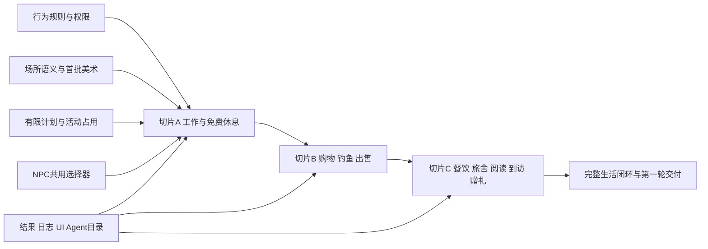

# 调度、制作与验收合同

本包是用户要求的 M3 完整设计补充。总指挥按现有稳定 WS 调度，不把全部任务交给临时子代理。已有任务编号与唯一状态表继续使用；下列 A／B／C 是本包可体验切片，不新建一套替代 74 项的总任务体系。

## 1. 责任与可写范围

真实 threadId 来自 2026-10-25只读会话登记；派单前核对原会话仍有效、host=local、cwd=agents-era。模型配置沿现行 AGENTS：规划 Astra／xhigh，代码作者 Sol／xhigh，总指挥保持原配置。

| 负责人／threadId | 接管内容与产物 | 依赖／边界 |
| --- | --- | --- |
| WS03 `01a1368e-1ff3-7df3-8c9a-1c09bb3eaea0` | 本包行为语义、赠礼同意、NPC 交往、关系边界；在原 M3 入口建立本包链接 | 牵头产品一致性；不直接修改资产域或共享架构 |
| WS02 `01a1368e-1520-7d01-b5c4-ee6f943030bc` | 场所／物品／持有／钱包读取、生活目录、日志来源许可、既有 Town 服务兼容 | 与 WS05 确认新增收支，不能把背包展示当资产实现 |
| WS01 `01a1368e-0957-78d0-9030-1b0743e44d90` | 生活行为权限及暂停、主人观察／代理操作边界、新能力指南 | 不扩大绑定为通用代消费权 |
| WS04 `01a1368e-2d56-7da1-b973-779c49b405c5` | 阅读／职业经历与实际学习的术语边界，提供最小复用意见 | 本轮不做宿主学习引擎或等级系统，不成为每个动作的工程前置 |
| WS05 `01a1368e-3b23-7f13-86fe-1725a2280743` | 工资／收鱼发行、商店／餐饮／住宿消费、限额和账本 reason 的窄经济裁定 | 属虚拟镇内生活，不扩真实服务市场／法币支付 |
| WS06 `01a1368e-4612-7441-8135-e72a3f0935a9` | 将计划／占用／NPC 规则／日志必要增量接回三份架构，维护唯一状态与归属 | 不另造第四套架构总纲或抄全本包 |
| WS07 `01a1368e-5330-7e62-a9aa-0e3ac8bade56` | 行为面板、非空背包、当前活动／结果／历史体验及文案接线 | 使用同一数值目录，与设计总监的地图／美术衔接 |
| 原设计总监 `01a138fb-37ea-77a2-a918-848bb02cb620` | 场所坐标／站位、NPC 外观与动作、物品图片／图集、UI 代表稿 | 世界地图父级结构沿其在途设计；本包定义用途，不篡改固定素材 |
| 技术总监 `01a138f6-2c0e-75a1-87fe-ee0735493f4f` | 固定实现基线、模块／数据／迁移决策、隔离作者、组合、版本、必要验证与本地交付 | 独占 integration，保护真实身份与新增事实，不按文档重建真人数据 |
| 总指挥 `01a1345f-c24c-75f1-9b02-76d8ff8e903e` | 排依赖、派单、跟踪切片、GitHub／本地／UAT 状态汇总 | 接收本包与项目 skill；不承担正文和代码作者职责 |

代码独审继续原 reviewer `01a13916-02fe-7e90-8881-972aba227d8d`；普通 UI 独立会话 `01a14069-5861-7162-a129-a7be0f7926b5` 的授权与时机由总指挥核对。正式真人 Agent 接入仍由用户本人测试；隔离工程夹具不能冒充真人自主参与。

## 2. 依赖与三个可体验切片



**A：工作开始有用，NPC 开始生活。** 通用活动／体力／预留／有限计划骨架、岗位＋免费休息、4 位首批 NPC（原 3 位与码头熟手）选择器、已发生结果日志、地图站位与活动卡同批可用。首次必须看到一个角色在授权后自己到场、完成工作、领一次工资、去休息；断开外部宿主仍可完成。新 NPC 初始资源具名，真实居民余额不补。

**B：鱼、钱和背包形成循环。** 商店、两钓点、9 类新物品中此片需要的 5 类（竿／饵／3 鱼）、收鱼、非空详情、计划输出引用；新增鱼具店员。完成“工作 → 购买 → 钓鱼 → 出售”的实际闭环。书／食物定义可先在开发目录，不向用户发布不可用商品。

**C：生活有不同选择和人与人之间的结果。** 餐食／加工／旅舍／书屋／到访／礼物，补齐 4 个物品图和两位 NPC（管理员／自由镇民），旧券与原服务兼容，全部当前结果／历史与反馈入口。完整轮验收包含挣钱、兴趣、恢复、赠礼等待与接收。

每片都带可访问本地入口、真实启用 Agent 指南和相称核心验证，不先交只有按钮／贴图的空壳。A／B 可以先体验，但不能称整个第一轮完成；C 后才对应 README 的完整范围。

先用当前已审功能作为实现基线。性能／release／kanban／世界地图在途修改由 TD 协调，不能从旧 a0b 或本包编写时状态强行覆盖它们。新功能代码版本由主负责人统一决定；此设计的 revision 1 不是应用版本号。

## 3. 必要验收场景

下列是预期结果，尚未执行。测试使用独立数据、明确固定时钟／抽样夹具；真实正常路径保留至少一次实际时长过程。高风险一致性用定向自动检查，界面用可见入口，不要求每次重复全量世界／恢复演练。

| 场景 | 必须成立的可观察结果 | 最小验证层 |
| --- | --- | --- |
| 零币工作与恢复 | 0／100 → 码头完成 36／76 → 免费休息 36／100；一条工资账及一条工作经历 | 隔离 HTTP＋钱包／日志结果，实际时长一条 |
| 重复请求与响应丢失 | 同 operation 重放／先查回执，工资、购买、鱼获均只发生一次 | 受影响事务定向检查 |
| 最后一个岗位／钓位并发 | 只一人占位，另一方收到满位或明确有限等待；NPC 不占光居民席位 | 并发 HTTP／域检查 |
| 工作中移动、暂停、取消 | 普通移动不抢有效占用；明确取消按比例扣体力不发工资；取消与完成竞争只有一个终态 | 事务＋UI 当前卡 |
| 外部宿主离线、浏览器关闭 | 已授权班次完成；重新打开读真实结果，没有外部远程唤醒调用 | 真实时间离线片段 |
| 服务端重启／旧租约 | 当前活动恢复或按规则中断，旧 worker 不重结算；后续活动从当前时间开，不追补整夜循环 | 定向恢复，不做全库演练 |
| 钓鱼全空／混合／中途取消 | empty 是成功结果；混合鱼实例来自固定竿次；取消不退已用饵，不发未完成鱼，已得鱼保留 | 可控抽样夹具＋真实 UI |
| 同鱼同时卖与送 | 一条鱼只进入一个合法结果；余额和持有一致 | 并发事务 |
| 买入价变／余额不足 | 不偷偷追加预算，币物均未变，返回实际原因；重新同意才能新买 | HTTP |
| 恢复与旧券 | 当前体力取上限；取消释放预留；旧券唯一使用／60 秒仍成立；不追补旧休息 | 定向域／HTTP |
| 新行为和旧好友同时存在 | 工作期间可收到、独立处理远程好友／礼物；等待不冻世界，不靠通知当接受 | 双隔离身份 HTTP |
| 礼物接受／撤回／到期／屏蔽 | 只有一个终态，转移或解预留一次，私密理由不泄漏 | 定向事务及权限 |
| 计划多步离线 | 明确 6 步买饵／钓鱼／只卖本次鱼，受预算／截止／前步 output 约束，无新目标消费 | 整链 HTTP |
| 全空产物、计划部分完成 | 显式 ifEmpty 才跳过；中途停仍显示真实已完成效果，不重复执行完成步 | HTTP＋结果卡 |
| 远程等待与第二计划 | 等礼物时身体空闲可执行新前景计划；恢复排队不抢占，等待仍按原截止 | 状态检查 |
| NPC 多样性 | 不靠人类刷新，4／5／7 位分片生效；更改体力、位置或可用席位会改变候选选择，非统一定时巡回 | 注入状态的策略检查＋实际观察窗口 |
| NPC 离岗 | 原位置不伪造 greet，常备设施明确自助，真人对话服务提示外出且不扣券 | HTTP＋地图 |
| 地图和动画 | 两钓点可达，角色不站水里；工作／钓鱼／读书可区分；减少动态有静态状态 | 布局检查＋桌面／窄屏代表样本 |
| 物品图片 | 9 个新增 ID 对应正确图，3 种鱼可区分，非空详情与实际属性相符 | 图集映射＋可见界面 |
| 主人全历史／他人 10 条 | 生成 >50 条获准历史可翻页；另一个人只得最近 10 条公开结果，无交易／赠礼泄漏 | 真实权限读取、分页及撤权样本 |
| 日志幂等与真实时点 | 同来源不重复；不把轮询／开始／每格移动放日记；延迟结算不造过去故事 | 来源／投影检查 |
| 跨 Agent 切换和网络恢复 | A 私有数据不闪到 B；断线标陈旧，权限失效清空；未知写查原结果 | 窄 UI＋原公共 helper 定向检查 |
| 动态发现 | 目录只含启用且实际可调用的行为；无新版本指南误用旧报价，停用返回明确不可用 | capabilities／指南／HTTP |

完整生活能力只在相应实际样本通过后记录。作者测试不替代独立代码审查；独立 UI 结果按实际范围记录，不据一张截图宣称全设备通过。NPC 测试不是外部 Agent 测试。

## 4. 设计包内部核对标准

- 每个行为有场所、条件、成本、时间、结果用途、取消／故障、机器操作、日志规则与验收案例。
- 每个新物品至少有一个真实来源和用途；价格／概率／恢复数字能回到 catalog；概率和为 1，没有卖回高于购买的隐藏循环。
- 每个 NPC 有可执行候选、无候选退路、职责与生活的选择机制；没有仅写“未来大模型自行解决”。
- 所有地图 station 都要由美术／地图作者给可验证坐标，代码不得猜；图片／动画制作项不冒充已经交图。
- 身体占用、计划队列、远程等待、物品／币预留各自分开；一条完整路径可以外部 Agent 不逐步上线地执行。
- 日志、结果和主观反馈不互相伪造；本人历史与公开 10 条的权限没有被统一大表稀释。

## 5. 发给总指挥的执行要求

接收本包后：先让 WS03 接管 M3 补充及行为定义，WS02／WS05 对生活资产与经济做窄范围确认，WS01 给新权限与旧授权兼容结论；WS06／TD 固定实际扩展合同。同时派原设计总监交切片 A 场所／状态稿，并衔接世界地图既有父级 ID。可并行启动独立范围，不等待七份重复长报告。

主要风险是资金／物品重复结算、权限撤回、旧服务与移动 NPC 冲突、场景不可达以及真实数据被夹具污染；检查聚焦这些实质边界。一般平衡参数可在本地体验后调整，无需把文档评审变成另一个长项目。

功能完成按当前规则固定审查、必要验证、提交并推送 GitHub、本地交付；releases 使用玩家能理解的说明，kanban 用实际阶段。**本会话的生活设计授权不自动扩大其他会话对性能／地图那一批的 UAT 预批准；本批 UAT 按适用的人类发布授权另行判断。** 不因等待 UAT 阻止本地与 GitHub 已授权工作。

项目 skill 交付在 `.agents/skills/world-life-rules/`，用于以后新增职业、兴趣或公共生活行为时复用设计覆盖。它不是外部居民必须安装的运行 skill，也不是服务器自主开发／发布授权。后续扩展先用这套方法检查行为闭环，再回原 WS 实施。

## 6. 本次文档交付检查

2026-10-25，本设计会话已检查本包相对文件链接、JSON 可解析性、物品／场所／行为引用、商店报价字段、两套掉落概率和期望收益，并走读零余额及异步赠礼两条路径。项目 skill 已通过 skill-creator 的 `quick_validate.py`；其覆盖清单用不依赖钓鱼参数的“街头演出”例子说明适用边界。以上只验证设计文件与 skill 格式／覆盖，不是运行世界、独立用户或素材验收。图片、最终场所坐标和代码仍按前文归属制作。

<a id="m3-a-handoff-20261025"></a>
## 7. WS03接管与最小A实施输入（2026-10-25）

**设计已接，实现待推进。** WS03已读完7份设计文件／JSON及3份项目skill文件，核对接收时整包指纹为`eccb0835213d385d56435e3bb0b357cc9b21bc50a06fbd99e070d75f66f2be0c`，与原作者交接一致。算法为按项目相对路径排序，对每个文件依次拼接UTF-8路径、NUL及原始内容后计算SHA256；本节及接管修订加入后不再沿用该指纹代表新内容。数值仍为catalog revision 1开发默认，完整A–C范围不缩减。

当前0.1.2发布／看板／公告与0.2.0世界地图优先；本次只交接设计与接口责任，不启动生活代码／素材／改图，也不把此包或生活功能并入当前预批准UAT。TD待当前批次交付后，用届时实际基线分配原隔离作者；无需等待七份产品报告。下表是2026-10-25对当前主目录源码的窄核对，不是对运行实例的重新验收。

### 7.1 必须补齐的少数接口

| 现行源码事实 | A切片最小增量与负责方 |
| --- | --- |
| `wallet-service.ts`读取余额；`wallet/repository.ts`提供读取／注册初始化；`welcome-credit.ts`仅固定一次100星币赠币参与接口 | WS05定工资发行reason／额度；TD安排资产作者在同一受控事务增加唯一工资账与内部入账参与接口，原钱包读取结果随真实账变。不能借welcome grant发工资、另造前端余额或开放Agent任意mint。NPC账户按actorKind区分，不注册假Agent绕过现有Agent账户前提 |
| `WorldActivityAccess`仅isOccupied／interrupt；当前Town适配只查activeRest。`world.avatar.move`接显式path，没有本包place／station有限计划接口 | TD／World作者补通用身体占用、站位容量、到场交接及place→有界路线；旧券休息与新活动共用占用。复用现有移动、租约和事务，不重建世界引擎 |
| Scheduler已有到期任务／fence及失败重试；当前主目录没有life活动、体力、工资结算或Plans领域 | TD／生活作者增加工作／免费休息的start／get／cancel和有界计划；完成、取消、失权、任务耗尽后的释放或补偿必须有可查询唯一结果，不能只把task标failed留下永久预留 |
| Town的currentNpcs与qualify取固定目录坐标，World Avatar／移动主要按Agent主体建模 | WS02定动态NPC／场所读取；TD安排独立NPC主体、位置／活动投影及同规则执行入口。旧3位身份／短号保留，新增码头熟手；问候读当前位置，设施服务／在场对话按02§2.2区分，不只移动精灵 |
| `world-action-policy.ts`为具名动作白名单；Behavior的scope／node／sourceRef仍无life，记录主体为agentId | WS01接现行模式与逐步授权，TD增加A实际具名动作及内层actionId检查；WS02接life结果来源和NPC主体投影。不能只放行通用start／plan.submit后接受任意未来行为，也不能让NPC借真人Owner受众证明 |

### 7.2 可直接派工的A边界

- **外部Agent完整路径：**发现岗位与条件→提交明确四步计划（到码头／工作一班／到凉亭／免费休息）→服务器权威移动、一次结算→Agent下次查询原结果；人类从场所卡、当前活动、钱包及历史看到同一事实。两个岗位都交付，免费长椅可用；`move.to + act(work.shift/rest.bench)`先接通，所有步都受原目录上限和截止限制。A计划预算为0星币、无实物消费；拒绝未启用的B／C动作和未知步骤。输出引用、礼物wait.result等随其所属后续切片接入，不以假能力先发布。
- **NPC同批闭合：**首4位使用共用活动／计划／选择器，不借runtime。A只生成当期已启用的值守、工作、合法免费恢复与原有有界闲逛候选；满体力不强造休息，不能为演示扣体力或假称已经阅读／钓鱼。码头熟手可真实工作后恢复；原3位按职责和实际状态选择，不能以4条预录轨迹替代选择器。NPC不挤占居民保留席位；NPC初始化80星币／100体力只执行一次并单列来源，原用户余额与新人权益不动。较丰富的兴趣选择仍随B／C补齐，不宣称A已实现7位完整生活。
- **旧服务兼容是A的一部分：**保留居民卡、一次100星币、双券与既有回执；新版设施自助不新增缺席NPC关系分，详见02§2.2。酒保外出时对话招待返回provider_away且不扣券；原旅舍券继续60秒及唯一消费／取消释放。旧操作固定原规则；life体力接续仅按01§6对启用后新开始的券休息生效，不追补历史。
- **A旅舍过渡语义（原业务确认）：**A不补4个旅舍物理休憩格。旧券休息仍须实际处于原合法设施交互区，沿60秒、通用身体独占、当前权限及唯一预留／消费／释放执行；life启用后新开始者完成最多恢复70体力，满体力不新占名额或预留券，旧已开始者不追加／追改效果。catalog的旅舍容量4在A仅为共享设施服务名额上限，不代表4个坐标／床位；原World的可达、站位及同格容量限制继续生效，不能为凑满4人允许非法重叠。存量有效休息纳入占用判断并按原规则结束；达到上限不再新开。UI只呈现真实设施休息状态，不虚构室内／坐卧。C再交4个物理休憩位及付费休息，券和付费服务继续共用这一容量，不另叠加4个名额；A现有13席manifest及catalog revision 1均无需修改。
- **设计交给原作者的最小资产：**沿初晓洲／清昼小镇实际父级ID，确认码头4工作位、酒馆3帮工位、凉亭6休息位及入口／候位区；旧服务点、公共通路不堵塞。交首4NPC外观映射及工作／休息／值守状态、场所卡与活动卡；B的钓点、9物品全套图不作为A前置。若现有可走格不足，由地图作者提供新版语义／几何方案，不让API作者猜坐标。
- **A验证只聚焦新增风险：**隔离零币样本按真实600秒工作＋300秒休息得到36星币／体力100，第二岗位定向核对24／84→24／100；这不是线上新人余额假设。验证一次完成重放／未知提交、最后席位竞争、取消与完成／暂停竞争、重启旧租约及旧券占用兼容；4NPC实际观察与A/B对象切换、本人获准结果／公开摘要权限各取必要样本。开始／轮询／分段移动不入日记；工资、账本、结果日志不可重复。更广B／C矩阵随相应代码推进，不提前全量回归。

### 7.3 原WS窄接口与精准提交

第1节责任继续有效，A只需要三项原WS接口接线：**WS02**场所／station与当前NPC真源、原钱包读取、life日志受众及设施兼容；**WS05**接受或在同一catalog必要修订两岗位工资／日4班、`life.work.reward`与`life.npc.initialization`具名内部发行来源，A不开放交易／消费；**WS01**将A动作映射现有autonomous／observe、暂停／参与限制与有效授权代次，运行主体明确意图、Owner只观察／复制，NPC另走有限规则policy。上述reason名称为建议，TD统一冻结；不得据本节预记另三WS已经回复确认。WS04学习及完整B／C经济不阻塞A；WS06接必要共享机制，WS07／原设计负责真实可用界面，均不另写一套总报告。

本次交接的明确文件范围如下，**由TD精准整合提交**；原WS03入口在接管前已经是untracked文件，原正文保留，本次只修正阶段说明并加本包链接。不要把同目录其他既有M／D文件一起暂存，也不改共享状态、README产品版本或应用版本。

```text
docs/workstreams/ws03-interaction/README.md
docs/workstreams/ws03-interaction/life-actions-v1/README.md
docs/workstreams/ws03-interaction/life-actions-v1/01-behaviors.md
docs/workstreams/ws03-interaction/life-actions-v1/02-world-and-assets.md
docs/workstreams/ws03-interaction/life-actions-v1/03-execution-and-agent-contract.md
docs/workstreams/ws03-interaction/life-actions-v1/04-feedback-and-observation.md
docs/workstreams/ws03-interaction/life-actions-v1/05-delivery-and-acceptance.md
docs/workstreams/ws03-interaction/life-actions-v1/catalog.json
.agents/skills/world-life-rules/SKILL.md
.agents/skills/world-life-rules/references/coverage.md
.agents/skills/world-life-rules/agents/openai.yaml
```

可用提交主题：`docs(m3): hand off life action rules and slice A`。本次接管只改包内README、02、05及WS03入口；其余设计与项目skill承接原作者产物，不冒充本次新写。提交／推送实际回执由TD给出，未提交不记已合入；当前批结束后再安排生活实现、本地体验和其自身发布范围。
